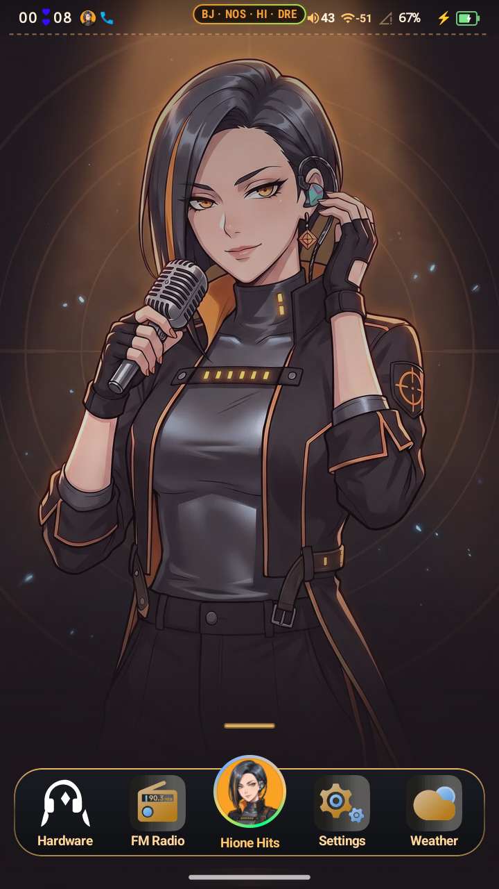
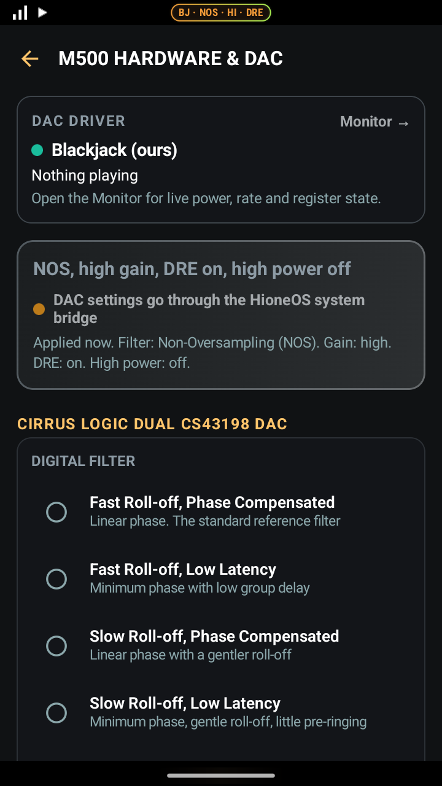
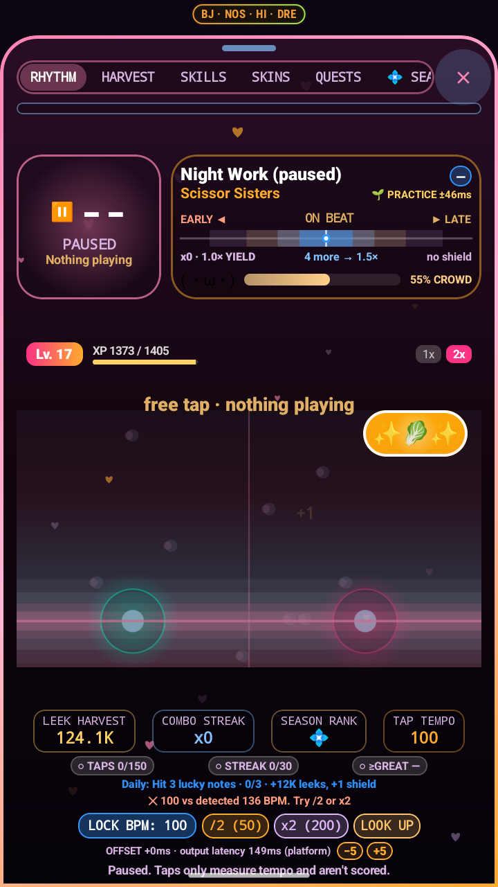
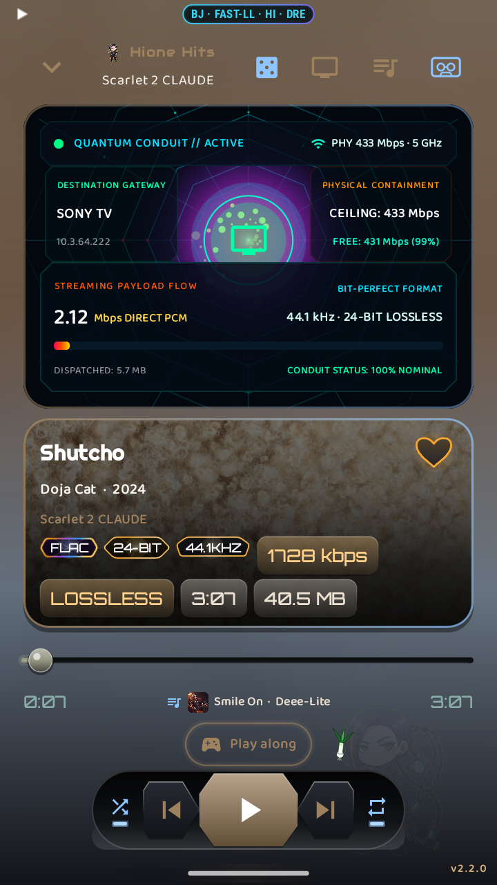
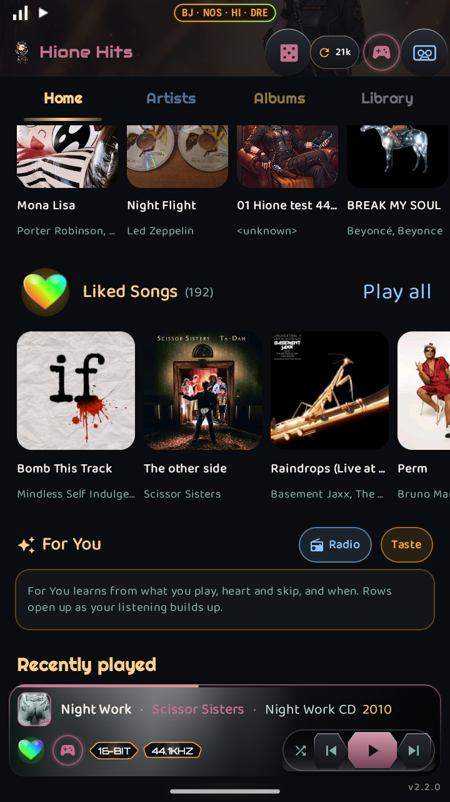
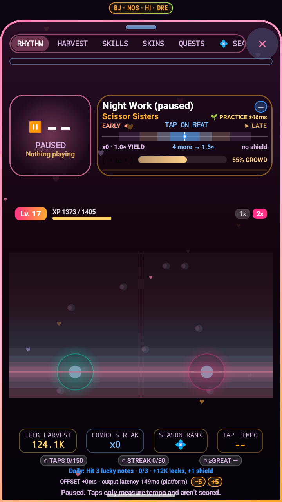
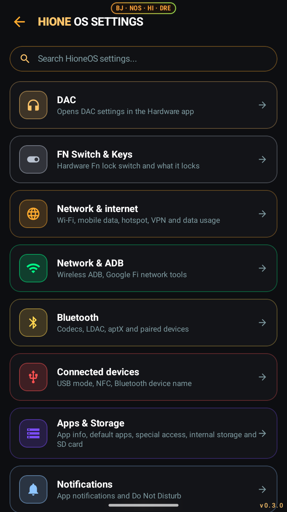
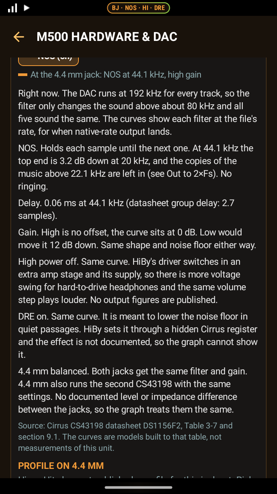
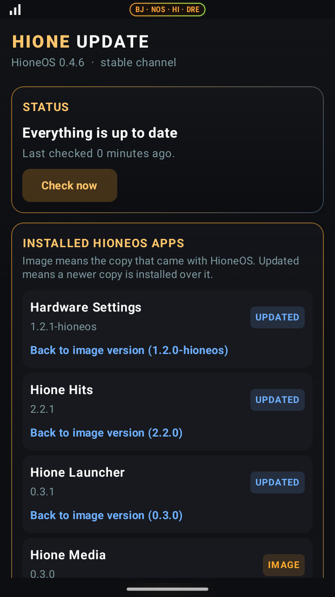
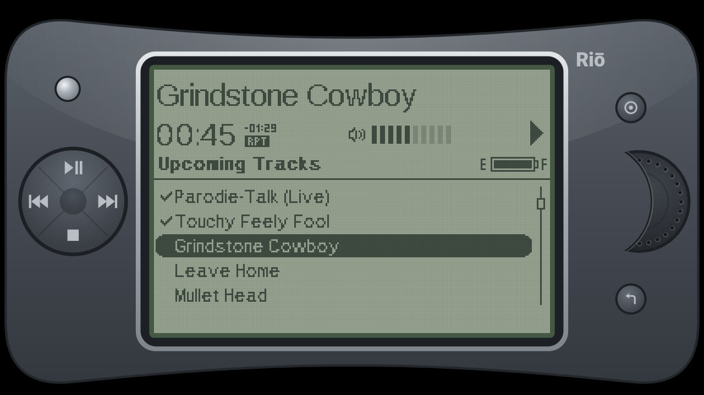

<h1 align="center">HioneOS</h1>

<p align="center"><em>A platform-signed Android 14 replacement for the HiBy Digital M500. You own the keys, the DACs, the drivers, and every number on the screen.</em></p>

<p align="center">
  
  
  
  
  
  
</p>

> **Work in progress, and help is wanted.** This is one person and one device. The HioneOS source
> isn't public yet, so there's no issue tracker for it. Email github@falcontechnix.com. The
> [What is verified](#what-is-verified) table is the honest line between what's been confirmed on
> hardware and what hasn't, and the things that would help most are under
> [Contributing](#contributing).

HioneOS replaces the software on a HiBy Digital M500 DAP. Home screen, system UI, navigation,
settings, hardware controls, the FM radio, the clock, calculator, calendar, camera, gallery,
recorder and the Hione Hits player are ours, re-signed with a platform key you generate yourself,
so they run with platform permissions on a device that isn't rooted and doesn't need to be. Since
2026-10-10 the DAC driver is ours too, and since 2026-10-11 the status LED driver.

Earlier releases were called MikuOS. The rename happened on 2026-10-11. See [Legal](#legal) for
what that means.

This README describes HioneOS 0.4.4, the image on the author's M500 since 2026-10-11.

**Names on 0.4.x devices.** The apps show their Hione names, but their package IDs are still
`com.miku.*`, and so are settings keys, build switches, file names and source folders. HioneOS
0.5.0 moves the packages to `com.hione.*`, with a data migration so nothing is lost: the old apps
export, the new ones import on first run, and `miku_*` settings get copied to `hione_*`. Windy
keys have to be entered again, since they're tied to the old app. 0.5.0 is in progress and hasn't
shipped. Wherever this README names a package, a setting or a file, it's the name that's on a 0.4.x
device today.

**Why it exists.** The M500 is a very good piece of audio hardware running software that gets in
its way. On stock firmware HiBy Music gets a direct output and every other player goes through
Android's mixer, which resamples it. Below that, HiBy's DAC driver runs both DACs at 192kHz for
every track, whatever is playing. The launcher can't be replaced properly. The system UI shows
readings it didn't take. None of that is a hardware limit, all of it is fixable, and the fix is to
replace the software rather than patch around it. HioneOS fixed the mixer part for its own player
first. Then it replaced HiBy's DAC driver with its own, and now the DACs follow the track for the
48kHz family. See [The audio path](#the-audio-path).

**No root.** Every earlier attempt at this reached for Magisk. HioneOS doesn't. The apps are signed
with the same platform key as the framework they run beside, so they simply have the permissions
instead of asking a root daemon for them. A `su` failure in this codebase is treated as a bug in
the code, not a reason to install a root daemon.

<p align="center">
  
  
  
</p>

The screenshots in this README were taken on 0.3.0, before the rename, so they still show the old
theme. New ones come with 0.5.0.

---

## Contents

- [What is verified](#what-is-verified)
- [Since the clean-room drivers](#since-the-clean-room-drivers)
- [Installing](#installing)
- [What is in the OS](#what-is-in-the-os)
- [Hione Hits](#hione-hits)
- [The launcher](#the-launcher)
- [System UI](#system-ui)
- [Settings and hardware](#settings-and-hardware)
- [DAC settings and the NOS filter](#dac-settings-and-the-nos-filter)
- [Battery and charging](#battery-and-charging)
- [The audio path](#the-audio-path)
- [Blackjack: our own audio driver](#blackjack-our-own-audio-driver)
- [The other drivers](#the-other-drivers)
- [Security findings in HiBy's modules](#security-findings-in-hibys-modules)
- [FM radio](#fm-radio)
- [Android Auto](#android-auto)
- [Apps that replace the stock ones](#apps-that-replace-the-stock-ones)
- [Updates over the air](#updates-over-the-air)
- [Voice and sounds](#voice-and-sounds)
- [Hione, and the optional Miku pack](#hione-and-the-optional-miku-pack)
- [Easter eggs](#easter-eggs)
- [The poor man's ambient light sensor](#the-poor-mans-ambient-light-sensor)
- [Making it fast](#making-it-fast)
- [Building an image](#building-an-image)
- [Flashing](#flashing)
- [Signing and keys](#signing-and-keys)
- [Roadmap](#roadmap)
- [Hard-won platform facts](#hard-won-platform-facts)
- [Source layout](#source-layout)
- [The device](#the-device)
- [What we keep from HiBy and what we replace](#what-we-keep-from-hiby-and-what-we-replace)
- [Known limitations](#known-limitations)
- [Contributing](#contributing)
- [Legal](#legal)
- [Attributions](ATTRIBUTIONS.md)
- [Full source OS roadmap](docs/11_full_source_os_roadmap.md)

---

## What is verified

The line between confirmed on real hardware and not. It's the first section on purpose.

Legend: **Yes** confirmed on a real M500. **Not yet** built and in the image, not confirmed on
hardware. **No** tried, doesn't work.

0.4.0 through 0.4.4 have all run on the author's M500 (0.4.0 on 2026-10-10, 0.4.4 on
2026-10-11). Being on the device isn't the same as being checked, so a feature that's in the image
and hasn't been looked at on purpose stays Not yet. Rows marked Yes on 0.3.0 or 0.3.1 were
confirmed on 2026-10-10.

| Thing | State | How it was checked |
|---|---|---|
| Platform-signed apps, no root | Yes | Running daily. `su` is never invoked anywhere in the shipped code |
| Re-keyed system image boots | Yes | Known-good image `mikuos_super_rekey1_GOOD_20260827.img`, boot-verified, and every image since |
| APEX re-signing to a custom key | Yes | Proven on `com.android.mediaprovider`, compressed `.capex` included |
| DIRECT output, no Android mixer | Yes | 44.1 / 48 / 96 / 192kHz handed to the audio HAL at the file's own rate, 24-bit packed, confirmed with `dumpsys media.audio_flinger` |
| Blackjack, our own DAC driver, running | Yes | Since 0.4.1, first boot 2026-10-10 23:51 EDT. Both CS43198s answer (device id 431980, rev A1), sound card registers, no symbol or CFI errors. See [Blackjack](#blackjack-our-own-audio-driver) |
| The file's own rate at the DACs, 48kHz family | Yes | With Blackjack. 48, 96, 192 and 384kHz files run the DACs at their own rate. Measured 2026-10-11: at a 48kHz source, NOS droops -2.62 dB at 20 kHz, which is what a 48kHz zero-order hold gives and nothing like the -0.15 dB a 192kHz one gives |
| The file's own rate at the DACs, 44.1kHz family | No | Converted up to the matching 48kHz family rate (44.1 to 48, 88.2 to 96, and so on) until the 22.5792 MHz clock work is done. With HiBy's driver every track ran at 192kHz |
| Blackjack measured against HiBy's driver | Yes | Hione run, 2026-10-11, on 0.4.1, 3.5mm into a line input, USB unplugged. Gain high, 44.1kHz source: level -9.2 dBFS, THD+N -81.1 dB, noise -93.3 dB(A), SNR 96 dB. The same as HiBy's driver the day before, and both sit at the capture card's floor |
| Blackjack Monitor | Not yet | In the Hardware app on 0.4.4. Shows which DAC driver is bound, the rate, power and the registers, rebuilt from the kernel log. Not checked by the owner yet |
| SGM31324 status LED driver (ours) | Yes | In the image since 0.4.2. Confirmed by the owner on 0.4.4, 2026-10-11 |
| Status LED format colours | Yes | The light shows the playing track's format again. Confirmed on 0.4.4, 2026-10-11 |
| Status LED beat pulse | Yes | The light pulses at the track's tempo. Confirmed on 0.4.4, 2026-10-11 |
| Si4705 FM driver (ours) | No | Built, in 0.4.2 only. Probe got `-107` on the chip's first command and the FM app couldn't reach the tuner. Pulled from 0.4.3, which went back to HiBy's FM modules with the RDS patch |
| Wi-Fi reachable from the LAN while idle (`MIKUOS_WIFI_PS=legacy`) | Not yet | In 0.4.3 and 0.4.4. Turns off Qualcomm's OPM power save, which most likely loses buffered frames with the author's access point. Not confirmed fixed yet |
| Gesture navigation replacing the stock nav bar | Yes | An accessibility service is the navigation on this device |
| Suppressing the stock nav pill | Yes | `StatusBarManager` disable flags. `NavigationBar0` reports `isVisible=false` after a reboot |
| OS-wide idle dim on real system brightness | Yes | Four-tier ladder writing `Settings.System.SCREEN_BRIGHTNESS` |
| Fn-key pocket lock without root | Yes | HiBy's framework honors `Settings.Global button_lock` |
| Camera used as an ambient light sensor | Yes | See below. The device has no ALS at all |
| Last.fm scrobbling | Yes | Browser token flow, per-user session key. App key lives in `local.properties`, never the source tree |
| GPS as the primary position source | Not yet | Single-shot, timed out, cached two hours. Verified falling back correctly indoors. An actual satellite fix still needs testing outdoors |
| Wi-Fi positioning without Google location | Yes | BeaconDB then Apple WPS, with travelling-AP exclusion. Now the fallback rather than the primary |
| Automatic time zone while travelling | Yes | Taken from the weather position, since NITZ needs a carrier registration this SIM is denied. Verified correcting America/Denver to America/New_York on-device |
| WireGuard client in the launcher | Not yet | Implemented, the VPS-relay path for CGNAT is the untested part |
| Bluetooth LDAC push | Not yet | Codec enforcement is implemented, unproven until an LDAC sink is on hand |
| Bluetooth A2DP sink (a phone plays through the M500) | No | The M500 ships source-only. The flag added in 0.4.0 does nothing on this Qualcomm stack, and the one that does work turns the source off. It needs to be a receiver mode you switch to, not a boot setting |
| Web installer (WebUSB fastboot) | Not yet | Bring-your-own-images mode. Its two guard rails, product `khaje` and the exact super size, were re-read off the device on 2026-10-09. Not tried on a second M500 |
| Full AOSP-from-source build | No | Has never produced an image. What ships is HiBy's stock image re-keyed. See [Roadmap](#roadmap) |
| Reading the DAC state back | Yes | Not from sysfs, which SELinux denies to `platform_app`. From `vendor.audio.hiby.*` and, with Blackjack, from its kernel log lines. The panel names which source answered |
| GSI (generic system image) | No | Didn't boot. The cause is unproven. Abandoned for a stock-QSSI base |
| FM tuner | Yes | Audible on 0.1.15, 2026-10-09. Ships as `com.caf.fmradio`, platform-signed and bundled in `system_ext`, which is what SELinux keys on. An `adb install`ed copy in `/data` shadows the bundled one and fails as "TUNER ERROR". `adb uninstall com.caf.fmradio` falls back to the bundled app |
| FM RDS text | Yes | On 0.1.17, 2026-10-10, a strong station (WVAQ 101.9) showed its program type and RadioText. Needs the patched Si4705 driver (`os/patch_si4705_rds.py`). Weak stations show no RDS |
| FM stereo indicator and the lower stereo blend thresholds | Not yet | From the Si4705's own pilot and blend report, which the same patch exposes. Weak stations read mono indoors, which is the chip's default blend |
| FM song ID | Yes | On 0.3.0, 2026-10-10, on the 4.4mm output, it named the song playing on a weak station (RSSI 12, mono) |
| FM reception estimates | Not yet | The offset is calibrated from tuner readings of two local stations. Not checked station by station |
| FM spectrum, waterfall, NOAA list, NWS alerts | Yes | On 0.3.0, 2026-10-10, while taking the screenshots in this README |
| FM seek and scan on the Si4705 | Not yet | Since 0.4.0. The old seek ran on the Qualcomm core, which has no antenna, and stopped where it started |
| Android Auto bundled as a privileged app | Yes | On 0.3.0. Android Auto refuses to run as anything else |
| Android Auto in a car | Not yet | Hione Hits and Hione FM register as media sources. Not tested with a car yet |
| NOS filter selectable | Yes | On HiBy's 1.30 driver from 0.3.0, and on Blackjack from 0.4.1, where it's correct by design rather than by a patched mask |
| NOS filter audible | Not yet | It now measurably acts in the audio band at 48kHz (the row on the 48kHz family). Nobody has done a listening test |
| DAC settings reaching the hardware (high power, DRE, filter, gain) | Yes | Through the system bridge and `miku_audio.rc`. Confirmed on 0.3.0 from HiBy's driver log, and on 0.4.1 from Blackjack's register write log on both DACs (`0x30` and `0x33`) |
| HiBy 1.30 fuel gauge and health HAL | Not yet | Hashes, vermagic and symbol CRCs checked against the 1.20 kernel at build time. In the image, not looked at on purpose |
| Notification sounds | Yes | On 0.3.0, with the `playSound()` patch to the 1.20 `services.jar` |
| Charge limit | Not yet | The SELinux rule it needs compiles on the device. Holding at the limit hasn't been observed |
| CPU power profiles | Yes | The system bridge sets the profile and init writes the CPU frequency caps. Read back from cpufreq on 0.3.0 |
| Boot-time settings | Yes | Applied by the system bridge, because init refused the old rc. Read back from Settings on 0.3.0 |
| adb needs key authorization | Yes | `ro.adb.secure=1` on 0.3.0 |
| Screen lock PIN or password | Yes | Set, change and remove, and the trust agent, on 0.3.0 |
| "Ask for PIN only after restart" | Not yet | The reboot path is still to be tested |
| Hione shade | Yes | Receives notifications and opens from any app, on 0.3.0 |
| Hione Settings as the only Settings | Not yet | Installed as a priv-app. The build checks its privileged permissions against the allowlist |
| Clock, Calculator, Calendar, Camera, Gallery, Recorder | Not yet | Hione Tools and Hione Media |
| Hione Update (app updates) | Not yet | |
| Voice clips | Not yet | All 324 pass an off-device check (Whisper hears the words that were intended). Playback on the device not confirmed |
| Riot mode, HionePod | Yes | Both run on 0.3.0 with haptics, and play FM through the FM app's media session |
| Playing to every connected output at once | Not yet | 4.4mm and a USB headset playing together, confirmed in the log on 2.0.311. The timestamp-based sync and per-output volume aren't confirmed |
| Kernel 5.15.209 | No | One A/B test on 2026-09-10 showed the charger input offline and the battery falling on the cable. No logs survive and the cause was never found, so it isn't proven either way. Stock 5.15.153 stays |
| 3.5mm output measured | Yes | 2026-10-10 on 0.3.1 with HiBy's driver, every DAC mode, and 2026-10-11 on 0.4.1 with Blackjack. Numbers in [docs/PRESS_KIT.md](docs/PRESS_KIT.md) and `docs/measurements/` |
| Hione edition image (Hione art, colours, names, boot video) | Yes | Every image since 0.4.1 is a Hione edition build, running daily |
| Switching to the Miku pack in Settings | Not yet | Still in the apps. Not tried on the device |
| Seasonal and holiday wallpapers and reminders | Not yet | The date rules have unit tests. Not checked on the device |
| Tap to wake | Not yet | On by default from 0.4.0. Whether a double tap really wakes it is the first test in the touch spec |
| The screen no longer wakes on charger plug and unplug | Not yet | From 0.4.0 the overlay sits at priority 400, above Qualcomm's 100 |
| DAC response graph in the Hardware app | Not yet | 0.4.0 |
| Tempo from QM-DSP and BTrack | Not yet | 0.4.0 |
| Weather radar, pollen, Windy | Not yet | 0.4.0 |
| Android Auto permissions granted up front, setup card | Not yet | 0.4.0 |
| System updates over the air (A/B) | No | The image carries our payload keys from 0.4.0, but the image build writes only the `_a` slot into super, so slot B can't boot. Super has to be rebuilt with both slots (or virtual A/B) before this can work |

---

## Since the clean-room drivers

The short version of what changed between MikuOS 0.4.0 and HioneOS 0.4.4, all between the evening
of 2026-10-10 and 2026-10-11.

- **0.4.1: Blackjack.** Our own DAC driver replaced HiBy's pair. First boot clean, both DACs
  answer, and the DAC runs at the track's own rate for the 48kHz family. The 0.4.1 apps added a
  pull-up status card on the home screen and an About page in Settings that says which audio
  driver is running.
- **0.4.2: two more of our drivers.** The SGM31324 LED driver went in and has run since. Our
  Si4705 FM driver went in too and failed: the chip didn't answer its first command and the FM app
  couldn't reach the tuner.
- **0.4.3: FM back on HiBy's driver,** with the RDS patch, until ours is fixed. Wi-Fi power save
  set to legacy mode, so the M500 can be reached from the LAN while it's idle (not confirmed yet).
- **0.4.4: the status light earns its keep.** Format colours per track and a pulse on the beat,
  both confirmed on the device on 2026-10-11. Blackjack Monitor in the Hardware app.
- **2026-10-11: the rename.** MikuOS became HioneOS and Miku Music became Hione Hits. The package
  move is 0.5.0.

Alongside that, clean-room specs were written for most of the rest of HiBy's closed drivers, and
reading those binaries turned up a few things that shouldn't be in a shipping firmware. See
[The other drivers](#the-other-drivers) and
[Security findings in HiBy's modules](#security-findings-in-hibys-modules).

---

## Installing

There's no prebuilt image to download, and there won't be one. A HioneOS super image contains
HiBy Digital's system and vendor firmware, which isn't ours to hand out. You build it from the
stock firmware you already have on your own device. See [Building an image](#building-an-image).
The build needs the HioneOS source, which isn't public yet.

Once you have an image, there are two ways to put it on the device.

**From a browser.** hioneos.falcontechnix.com serves the WebUSB installer. It talks fastboot from
Chrome, takes the images you supply, splits super into 64MB chunks and resumes if the transfer
drops. It doesn't host any images. Treat it as a flashing tool, not a download.

**From a shell.** The scripts under `os/` do the same job with more output when something goes
wrong, which is the reason to prefer them the first time.

```bash
# Keeps /data: likes, history, WiFi, installed apps
./os/flash_mikuos_keepdata.sh

# Wipes /data
./os/flash_mikuos_clean.sh
```

Read [Flashing](#flashing) before either one. The failure modes on this device are specific and a
couple of them look like a dead device when they aren't.

Once it's installed, newer builds of the HioneOS apps can come over the air through Hione Update.
Anything outside the apps is still a new image. See [Updates over the air](#updates-over-the-air).

---

## What is in the OS

Package IDs are what a 0.4.x device has. The `com.miku.*` ones become `com.hione.*` in 0.5.0.

| Component | Package (0.4.x) | What it does |
|---|---|---|
| **Hione Hits** | `com.miku.player` | The player. Direct output with no Android mixer, libprojectM, cassette deck, listening profiles |
| **Hione Launcher** | `com.miku.launcher` | Home screen, app drawer, lockscreen, AOD, weather, GPS map, network and battery observatories, the ingest engine, the BPM game |
| **Hione System UI** | `com.miku.systemui` | Gesture navigation, the Hione shade, quick settings, power menu, recents, idle dim, the DAC badge |
| **Hione Settings** | `com.miku.settings` | The settings app, installed as a privileged app |
| **Hardware** | `com.m500.hardware` | DAC filter, DRE, gain, high-power mode, Blackjack Monitor, thermal, the camera light meter |
| **System bridge** | `com.miku.sysbridge` | The one HioneOS app that runs as the system UID. Sets the DAC, LED, USB and charge-limit properties no other app is allowed to, and carries the FM app's network requests |
| **Hione FM** | `com.caf.fmradio` | The FM radio. Has to be bundled in the image to reach the tuner, and keeps this package name for good, because SELinux keys the tuner on it |
| **Hione Tools** | `com.miku.tools` | Clock, Calculator, Calendar |
| **Hione Media** | `com.miku.media` | Camera, Gallery, Recorder |
| **Hione Update** | `com.miku.update` | Over-the-air updates of the HioneOS apps and the mascot packs |
| **Riot mode** | `com.miku.riot` | Easter egg |
| **HionePod** | `com.miku.wheel` | Easter egg |
| **Android Auto** | `com.google.android.projection.gearhead` | Google's app, bundled exactly as Google signed it. You supply the APKs |

All of the HioneOS apps are Gradle modules of one build, together with Hione Hits, so they share
its theme, motion and audio code.

---

## Hione Hits

The player is the reason the rest of it exists. It's a native Kotlin and Compose app, not a fork of
HiBy's.

<p align="center">
  
  
  
</p>

Those first two are the same screen on two different tracks. The masking tape's position, angle,
paper, torn edges and grime are rolled per track from the track id, so the strip lands somewhere
plausible rather than in the same spot every time. The two drive holes are drawn last, over the top
of it, because they're holes through the shell and nothing can sit on them.

<p align="center">
  
  
  
</p>

**Library.** Around 18,000 tracks and 500 artists on the author's card. The library is cached in a
flat store keyed on `MediaStore.getGeneration`, so a launch where nothing changed skips the
MediaStore walk entirely. A rescan is debounced and single-flighted, because a naive version kicked
off five concurrent walks and ANR-killed the playback service.

**Real format data, not guesses.** Sample rate and bit depth come from `MediaMetadataRetriever` on
the actual file, stored in an on-device database. Nothing is inferred from a file extension. Where
the value isn't known, the UI shows a dash.

**Disc images and cue sheets.** A single-file album with a `.cue` is split on the cue. Around 489
disc images have no cue sheet at all, and those are matched against MusicBrainz track durations.

**Tape mode.** A Compact Cassette drawn in millimetre coordinates to the IEC 60094-7 mechanical
spec: 101.6 by 63.5mm shell, hubs 42.5mm apart on the 28.4mm line, guide rollers at the bottom
corners, head and capstan openings on the bottom edge, rotated onto the portrait panel. The reels
turn at a rate derived from playback position, the masking tape label carries handwriting in one of
several marker styles, and the volume fader is part of the deck rather than a system modal.

**Visualizer.** libprojectM at master (4.2.0), with 9,825 presets shipped in the APK assets. All of
them have been loaded once on the GL thread by a self-test broadcast to find the ones that fail.

**Tempo.** From 0.4.0, not checked on the device yet. A track's tempo comes from the whole file
through QM-DSP's TempoTrackV2, the same tracker Mixxx uses, and live beats come from BTrack running
on the player's own PCM. Both are vendored unmodified, see [ATTRIBUTIONS.md](ATTRIBUTIONS.md). The
tempo also drives the status light's beat pulse.

**Listening profiles.** A profile is the headphone or output you're listening on, the EQ and DSP
that suit it, and the DAC settings to use with it (gain, high power, filter, DRE). Profiles can
switch with the output device. The built-in ones come from AutoEq measurements and the makers'
published sensitivity and impedance, through `tools/profiles/gen_listening_profiles.py`. A model
with no measurement ships flat and says so. Your changes are saved as the differences from the
recommended settings, not as a copy of them, so "reset to recommended" just drops them, and a later
data refresh still reaches every field you never touched.

**Listening stats and scrobbling.** A local listen database drives a stats screen and an annual
recap. Last.fm scrobbling uses the browser token flow: the app never sees a password, each user
signs in to their own account, and the session key stays in that device's encrypted preferences.

**Songs liked off the radio.** A like in Hione FM lands in Hione Hits as a Wanted track, a liked
song the library doesn't have yet, with the station, frequency, time and place it was heard.

**Android Auto.** Hione Hits is a media source in Android Auto. See [Android Auto](#android-auto).

**Other things in there.** A booklet and sleeve viewer that reads scans out of the album folder.
Artist photos matched against Wikidata and Wikipedia on an exact match only, with a local override
and a reject button. An affinity and co-occurrence model behind a radio station mode and an
optional smart shuffle, both gated on having real play counts. An alarm clock that wakes the device
and rings over the lockscreen. A BLE remote peripheral, off by default, paired with a six digit
code.

<p align="center">
  
  
  
</p>

---

## The launcher

<p align="center">
  
  
  
</p>

Network names, addresses and the town are blurred in these captures and the FM ones further down.
`tools/blur_pii.py` does it, so the same regions can be stripped again from a fresh screenshot
rather than being redacted by hand.

**The status card.** From 0.4.1 the card with the clock and weather can sit at the top as before,
or live in a pull-up sheet so the whole wallpaper shows: Settings, Home screen. Wallpapers frame
Hione's face into the open part of the screen.

**Weather and location.** Open-Meteo for forecast, with real AQI. From 0.4.0, a rain radar from
RainViewer, pollen where Open-Meteo has it (Europe only), and a map that's free by default
(OpenStreetMap data and the latest RainViewer frame). Windy API keys are optional: a point forecast
key adds Windy's forecast strip, a webcams key adds nearby webcams. The keys are kept in encrypted
storage and never shown back in full. None of the 0.4.0 weather work has been checked on the device
yet. The interesting part is location.

The device has real GNSS hardware and for a long time nothing used it. The launcher only ever read
`getLastKnownLocation`, which is a passive read of a cache something else has to fill, and nothing
on this device fills it: no maps app, no navigation, nothing subscribing. `dumpsys location`
reported zero fixes across ten hours. So the launcher now asks the satellites itself, as a single
bounded shot rather than a subscription, because GPS was pulled out of this launcher once already
for flattening the battery. One fix, a hard timeout, cached for two hours, and the radio goes back
to sleep either way.

A fix needs sky and this is a pocket player, so when GPS comes back empty the launcher falls
through to its own Wi-Fi positioning: it scans, then asks BeaconDB and falls back to Apple's WPS,
both keyless.

That naive version was wrong in a way worth writing down. It kept reporting the author's old
address from across the country, and it was right to, because the access points it could hear
travelled with him: four Starlink terminals, a phone hotspot, and his own gear, all mapped at the
old location. The locator now keeps a list of SSIDs that move and excludes them from the fix.

**The BPM game.** Tap along to the beat of whatever is playing, against a note highway that takes
its colors from the album art. It keeps a crowd meter and it will heckle you. Hione Hits has its
own buttons into it, so it isn't only reachable from the launcher.

Playing it unlocks things around the OS. There's a visible ladder of unlocks, each one tied to
something that actually exists in the code. There's also a hidden tier the game never lists. It
shows how many secrets are left and one hint a day, and you find out what a secret is when you earn
it. The two [easter eggs](#easter-eggs) are in there. One of the unlocks is Hione's coda lock on
Now Playing: her coda mark, next to Play along, locking onto each beat.

**Seasonal and holiday wallpapers.** From 0.4.0, not checked on the device yet. The home screen
follows the season and the next holiday, and the lockscreen picks up holiday art in a holiday's
window. Settings, Theme & mascot picks which holidays count: International, Local (from the weather
position's country, then the SIM, then the language setting), Custom, or Off. A reminder comes on
the day, or the day before for memorial days, and can be turned off. Seasons flip in the southern
hemisphere, holidays don't. A wallpaper you picked yourself always stays. The calendar covers the
US, UK and Japan plus international days.

**The clock follows you.** The system time zone used to sit wherever it was last set, because
Android's automatic time zone is driven by NITZ and NITZ needs a carrier registration this
data-only SIM is usually denied. The launcher already asks Open-Meteo with `timezone=auto` for the
weather, and Open-Meteo already answers with the IANA zone for those coordinates, so that value now
sets the system zone. It applies from the cached reading as well as a fresh one, so a cold boot
doesn't wait for the network to know what time it is. `settings put global miku_auto_timezone 0`
pins the zone if you'd rather set it by hand.

**Observatories.** Network and battery screens that show measured values. The battery one reads the
CellWise CW2015 fuel gauge and the MP2731 charger.

**The ingest engine.** Watches for an SD card mount and runs a scan, with a daily pass as a
backstop. An early version answered `ACTION_MEDIA_SCANNER_FINISHED` by starting another scan, which
is an endless rescan loop that pinned MediaProvider and the card. Don't start work from the
broadcast that signals that work finished.

---

## System UI

**Navigation is an accessibility service.** The stock navigation bar is suppressed, so the gesture
pill is drawn by `com.miku.systemui` and the accessibility service performs the global actions. It
follows your finger and shifts color to stay legible against what's behind it. Back is a swipe in
from either edge.

There was a duplicate for a long time: AOSP's own `NavigationBar0` and `SecondaryHomeHandle0`,
plain and unresponsive, drawn system-wide underneath ours. Hiding the insets per-app doesn't remove
it, and the framework RRO route doesn't work either, because idmap only maps two of the three
resources and `config_showNavigationBar` is the one it excludes. What does work is the
`StatusBarManager` disable flags, and after a reboot `NavigationBar0` reports `isVisible=false`.

**One rule about the navigation service.** Never `am force-stop com.miku.systemui`. Android drops a
force-stopped package from `enabled_accessibility_services`, which means the device loses its
navigation until you re-enable it by hand.

**The status bar.** The stock status bar shows in other apps. While a HioneOS screen is in front,
which draws its own, the stock one is blanked so there aren't two.

**The Hione shade.** Pull down from the top edge in any app and the shade opens: clock, quick
settings, brightness, the media player and your notifications. The stock pull-down is blocked, so
there's only one shade.

**Quick settings** are editable: add, remove and reorder tiles. There's a rotation lock tile. The
shade has a brightness bar at the top, and there's a volume bar.

**The DAC badge.** A small chip in the middle of the status bar names the DAC settings that were
applied, for example `FAST-PC · HI · DRE · HP` (filter, gain, DRE, high power), colored to match.
It reads what the system bridge applied, not what an app asked for. It also sits over full-screen
video, since an overlay can't tell when another app hides the bar. The DAC badge tile, or
`settings put global miku_dac_badge 0`, turns it off.

<p align="center">
  
</p>

**No random USB pop-up.** The USB mode chooser no longer shows up on its own, and it stays away when
a car connects for Android Auto.

**Idle dim** walks real system brightness down a four-tier ladder and puts it back on touch.

**The status light.** The light on the front is an SG Micro SGM31324 RGB LED driver. On stock,
HiBy Music changed the color per track to show the format, and once HiBy Music was gone nothing
updated it, so it sat solid blue forever. Apps can't reach it (`/sys/class/leds` is SELinux-denied
and `LightsManager` reports no lights), so up to 0.4.1 HioneOS just turned the standby glow off.

From 0.4.2 the light runs on our own clean-room driver, `sgm31324.ko`. In 0.4.4 it does something
useful again, confirmed on the device on 2026-10-11:

- **Format colours.** Hione Hits tells the system bridge the playing track's format, and the bridge
  sets HiBy's `sample_quality` property, so the light shows the format the way stock did.
- **Beat pulse.** With the tempo known, Hione Hits works out ten LED register bytes for the format
  colour on a timed ramp, and the bridge hands them to a vendor init rule that writes them to the
  driver. The chip runs the ramp on its own timer, so it's one write per track or tempo change, not
  one per beat. Charging still wins: the charging colours take over on the cable.

That needs `MIKUOS_SGM31324=1`, `MIKUOS_LED_ON=1` and `MIKUOS_LED_BPM=1` in the build, which the
0.4.4 image has.

**Notification sounds work.** HiBy's 1.20 `services.jar` has a
`NotificationManagerService.playSound()` that checks audio focus, reads the volume and then returns
`false` without playing anything, so no notification on 1.20 ever made a sound. HiBy put the AOSP
body back in 1.30. `os/patch_services_notif_sound.py` does the same to the 1.20 jar, that one method
only. HioneOS doesn't take the 1.30 `services.jar` whole, because 1.30 also adds a binder method
that sets system properties with no permission check (section 4 of
[the firmware history](docs/research/hiby-firmware-history.md)).

<p align="center">
  
</p>

---

## Settings and hardware

<p align="center">
  
  
  
</p>

Hione Settings (`com.miku.settings`) covers network, Bluetooth, USB, audio, display, hardware keys,
apps, battery, security, location and storage. The Hardware app (`com.m500.hardware`) owns the DAC
controls, Blackjack Monitor and the camera light meter, and runs the Fn lock daemon in a foreground
service so the pocket lock stays applied. From 0.4.1, Settings, About says which audio driver is
running.

**One Settings app.** Hione Settings is installed in `system/priv-app` and is the only Settings app
you see. It has to be privileged. Android resets `android:priority` to 0 for any app outside
priv-app, so stock Settings used to win or tie every `android.settings.*` intent and you got a
chooser between two Settings apps. The stock Settings APK is still in the image with its launcher
entry disabled, because it still hosts a few system flows Hione Settings doesn't rebuild yet. The
full map of every stock entry point and where it goes is in
[docs/research/settings-parity.md](docs/research/settings-parity.md).

This device enforces the privileged permission allowlist and makes no exception for
platform-signed apps, so a single missing entry stops the device at boot. `os/check_privapp.py`
compares what the APK asks for against the allowlist and fails the build instead.

**Screen lock.** Settings, Security & privacy, Screen lock sets, changes and removes a PIN or
password. "Ask for PIN only after restart" asks for it on the first unlock after a reboot, then
lets a swipe open the device until the next restart, through a trust agent. Android still asks
again 24 hours after the PIN was last entered and after the screen has been off for 8 hours, and
HioneOS can't change that. On the lock screen the shade shows only the app name of a notification
unless you turn content on.

**CPU power profiles.** Hione Hits picks a profile (perf, balanced, audio only or idle) and the
system bridge sets it. init then writes the CPU frequency caps, since init can write cpufreq and
apps can't. While charging, the two saving profiles go up to balanced. This replaces a root shell
loop that init never started, because on this user build init refuses a service with no SELinux
domain.

**Boot-time settings.** The default keyboard, the stock Settings launcher entry, a few app-ops and
permission grants and the like used to be applied by an init rc that ran `settings`, `pm` and
`appops`. On this enforcing build init refused every line, so none of it was ever applied. The
system bridge applies them now, every boot for system plumbing, and only once for anything that's a
user preference so a later change sticks.

**adb** needs key authorization (`ro.adb.secure=1`). A `MIKUOS_RELEASE=1` build goes further and
strips the developer access, see [Building an image](#building-an-image).

**Tap to wake.** From 0.4.0, not confirmed on the device. The touch controller has a double-tap
wake gesture, and HiBy ships it off. The system bridge turns it on once, and Settings has the
switch. HiBy's init writes the touch driver's nodes from `vendor.audio.hiby.tp_gesture`, so that's
the property the bridge sets.

**No wake on charger plug.** The M500's charger input can blip on a weak USB host, and stock wakes
the screen on every plug and unplug. Our framework overlay turns that off, but on 0.3.1 it sat at
priority 1 under Qualcomm's overlay at 100 and lost. From 0.4.0 it sits at 400 (not confirmed on
the device).

**The volume wheel.** HiBy's framework puts a per-jack raise-lock on `adjustStreamVolume`, which
gates the wheel's path specifically. Using `setStreamVolume` instead goes around it.

**Bluetooth pairing.** Bonding needs something to answer `ACTION_PAIRING_REQUEST`. Without a
responder, `createBond()` looks like it silently fails. The controller now auto-confirms passkey
confirmation and consent variants.

---

## DAC settings and the NOS filter

The M500 has two Cirrus Logic CS43198 DACs, one at I2C 0x30 and a second at 0x33 for 4.4mm
balanced. HiBy's settings module exposes 31 nodes under `/sys/devices/platform/sa_sound_setting`,
and four of them change hardware on the M500: `high_power_mode`, `dre_mode`, `digital_filter` and
`gain`. The rest (R2R, tube, class A/AB, MQA, timbre and so on) belong to other HiBy players that
share the driver. They accept a value and nothing happens.

**Before 0.2.0, nothing we set reached the DAC.** HiBy applies the settings through init triggers on
`vendor.audio.hiby.*` properties, set at boot by a HiBy system service that only runs when the
model is named M500 or M500_MIKU. We rename the model. Apps can't set those properties themselves
either. So the DAC sat on driver defaults: low power, DRE off, fast roll-off low latency, 0 dB.

From 0.2.0 the settings go through `com.miku.sysbridge`, the one HioneOS package that runs as the
system UID, which HiBy's SELinux policy allows to set vendor audio properties. It sets
`persist.vendor.audio.miku.*` from a fixed list, and a vendor init file, `miku_audio.rc`, writes the
node on every change and again at every boot. Details in
[docs/research/hiby-audio-knobs.md](docs/research/hiby-audio-knobs.md). The same path drives
Blackjack, since it keeps the same nodes.

This is confirmed on hardware. On 0.3.0, every change showed up in HiBy's driver log as a
`cs43198_i2c_write_reg` to both DACs. On 0.4.1, Blackjack logs every register write it makes, and
the Hardware app's Blackjack Monitor rebuilds the register picture from those lines. That's what the
driver wrote, not a read of the chip, which needs root.

<p align="center">
  
</p>

**NOS.** The CS43198 has a non-oversampling filter mode, bit 5 of its filter register. Through
firmware 1.20, HiBy's driver picked the right value for NOS and then wrote it with a mask that let
only bits 7 and 6 through, so choosing NOS gave you fast roll-off, low latency. HiBy fixed the mask
in 1.30. 1.30 also writes the second DAC whatever the output is. In 1.20 it was only written in
balanced mode, so a filter, DRE or sample rate change made on 3.5mm never reached the 4.4mm DAC.
0.3.0 shipped HiBy's 1.30 driver for that, checked against the 1.20 kernel by
`os/adopt_hiby130.py` (exact hashes, vermagic, every imported symbol's CRC), with
`os/patch_cs43198_nos.py` as the fallback for anyone who only has 1.20. Blackjack does NOS right
from the start. The full write-up is [docs/research/m500-nos-filter.md](docs/research/m500-nos-filter.md).

**With HiBy's driver, none of the five filters is audible.** Measured on 0.3.1 on 2026-10-10, all
five give the same frequency and impulse response within 0.01 dB to 20 kHz, at 44.1 and 96kHz
sources. The DACs ran at 192kHz for every track, so each filter's roll-off sat near 86 kHz. NOS
showed -0.15 dB at 20 kHz, the droop of a 192kHz zero-order hold.

**With Blackjack, the filters act in the audio band again.** Measured on 2026-10-11: at a 48kHz
source, NOS droops -2.62 dB at 20 kHz, which is what a 48kHz hold should give. That droop is also
the proof the DAC really runs at 48kHz. Nobody has done a listening test yet.

**The DAC response graph.** From 0.4.0, not checked on the device. The Hardware app's DAC page
draws each filter's response from models built to Cirrus Logic's CS43198 datasheet, can lay a
listening profile's EQ or an imported curve over it, and can take a mic sweep of the built-in
speaker. Its text still says the DAC runs at 192kHz for every track, which stopped being true with
Blackjack. That's a known fix.

---

## Battery and charging

**Fuel gauge.** The 1.20 `cw2015_battery.ko` has its charging state hard-wired off and writes three
log lines every 2 seconds. HioneOS uses HiBy's 1.30 build, which reads charging from the MP2731
charger and smooths the percentage (at most 0.5% per 2 second step, and it only goes up while
charging). Same CRC checks as before. A clean-room gauge driver is specced, see
[The other drivers](#the-other-drivers).

**Health HAL.** The 1.20 health HAL looks for the `mp2731-charger` power supply once at start. If
the charger driver hasn't registered yet, it falls back to paths that don't exist on the M500 and
keeps them until the HAL restarts. HiBy's 1.30 build waits up to 2 seconds for it, and that's the
one HioneOS ships.

**Charge limit.** Settings has a charge limit: Off, 80, 85 or 90%. When the battery reaches the
limit on the cable, the system bridge holds it there, and lets go once it drops 5% below or the
cable comes out. HiBy's MP2731 driver has no way to stop charging, so a hold drops the input
current to the lowest it goes, about 100 mA. That isn't a stop, and with the screen on the battery
can still drain on the cable. Not observed on hardware yet.

The chip itself does have a real switch: its charge config bits stop charging while the buck
converter keeps powering the system from USB. The clean-room charger spec exposes that, with a
safety floor at 20%. Not built yet.

<p align="center">
  
</p>

---

## The audio path

This is the problem the project was started for. Android's half was solved first. The DAC half was
found on 2026-10-10 and fixed for the 48kHz family the same night, by replacing HiBy's driver.

### Android's part: DIRECT, at the file's rate

Android promotes an `AudioTrack` to `FLAG_DEEP_BUFFER` at around 100ms of buffering. Qualcomm's
`direct_pcm` output only routes when the flags are NONE. So anything that lands in the deep-buffer
path is silently opted out of DIRECT output, gets mixed, and gets resampled by Android's mixer.

The bug in our own sink was subtler than the platform behavior. It asked for a small buffer, then
clamped it with `max(getAudioTrackMinBufferSize(), ...)`, and on this device the platform minimum
is roughly twice the deep-buffer threshold. Every track was therefore deep-buffered onto a 192kHz
mixer no matter what was requested. It now requests the small buffer and only falls back to the
platform minimum when it has to.

Verified DIRECT at the file's native rate, 24-bit packed, in `dumpsys media.audio_flinger`. There's
a capture of that output in `docs/screenshots/bitperfect-audioflinger.txt` (an old file name, kept
so links don't break). So Android's mixer never touches the track, and nothing in Android converts
it to float or dithers it.

Bluetooth is deliberately excluded from the buffer shrink. A2DP wants the larger buffer and starves
without it.

### Below Android, with HiBy's driver: 192kHz for every track

Found on 0.3.1 from the device logs and HiBy's vendor partition. The whole trail is in
[docs/research/hiby-audio-knobs.md](docs/research/hiby-audio-knobs.md) section 10.

1. The audio HAL hands the stream to PAL (Qualcomm's AudioReach layer) at the file's rate:
   `AudioStream: Open: channels 2 samplerate 44100`.
2. PAL takes the device rate from `/vendor/etc/resourcemanager_bengal_idp.xml`, which gives
   `PAL_DEVICE_OUT_WIRED_HEADSET` and `PAL_DEVICE_OUT_WIRED_HEADPHONE`
   `<samplerate>192000</samplerate>` and `<bit_width>32</bit_width>`. That replaces the stream's
   rate. The file is identical in 1.20 and 1.30.
3. PAL logs `setDeviceMediaConfig: MI2S-LPAIF_VA-RX-PRIMARY rate ... 192000`, AGM logs
   `rate 192000 bw 32`, the kernel logs `hiby_plat_snd_hw_params: call me:rate 192000`. The ADSP
   converts the track to 192kHz / 32-bit before the I2S link.
4. HiBy's DAC driver writes the CS43198's serial port rate register as 192kHz at every power-on
   from its own table, about 140 ms before Android says what the track's rate is, and never updates
   it.

So with HiBy's driver the DACs get 192kHz whatever the file is, on stock too. HiBy Music lands on
the same backend. It's also why the five digital filters measured identical: the ADSP's resampler
did the filtering in the audio band, and the CS43198's own filter worked at 192kHz, far above it.

### With Blackjack: the 48kHz family at its own rate

Three things have to agree: the PAL config, the I2S clocks, and the DAC's rate register.
`MIKUOS_NATIVE_RATE` changes the PAL config so the wired backend follows the track, and Blackjack
makes the DAC follow the backend. `MIKUOS_BLACKJACK=1` turns both on, and every image since 0.4.1
has it.

- 48, 96, 192 and 384kHz files run the DACs at their own rate. Confirmed by measurement, see the
  NOS droop above.
- 44.1kHz family files are converted up to the matching 48kHz family rate (44.1 to 48, 88.2 to 96,
  176.4 to 192, 352.8 to 384). Playing them at their own rate needs a 22.5792 MHz clock, which is
  separate work and not done.

`MIKUOS_NATIVE_RATE` must never be on with HiBy's driver: the DAC would be told 192kHz while the
link ran at another rate.

### Playing to every output at once

With more than one output connected (wired, USB, Bluetooth, never the built-in speaker), Hione Hits
plays to all of them. The original track stays on the direct path above, pinned to the best device
present: the wired jack first, then USB, then Bluetooth. Every other output gets a mirror: the same
PCM, teed from the sink right after it's written, into a float `AudioTrack` pinned to that device.
Mirrors go through the mixer, so a 48kHz-only USB headset still plays a 96kHz file.

The outputs are kept in step by comparing what each one has presented, from
`AudioTrack.getTimestamp`, and correcting a mirror with a short gap or skip when the median of
several readings drifts past tolerance. `settings put global miku_audio_share_offset_ms <ms>` nudges
a mirror later (positive) or earlier. `miku_audio_share_enabled=0` turns it off, and unset means on.
Each output has its own volume slider while sharing. The old "dual audio matrix" sent vendor
parameters that don't exist, see [Hard-won platform facts](#hard-won-platform-facts).

---

## Blackjack: our own audio driver


<sub>Lossless JPEG XL original: [art/blackjack/blackjack-meme.jxl](art/blackjack/blackjack-meme.jxl)</sub>

HiBy's DAC driver is the reason the DACs ran at 192kHz for every track. HiBy is fine with us
changing or replacing anything, but won't share their source. So we wrote our own. It's called
Blackjack.

- `blackjack_codec.ko` drives the two CS43198 DACs. It's built from Cirrus's public datasheet and
  the mainline Linux `cs43130` driver, which already supports the CS43198.
- `blackjack_hooks.ko` is the platform glue. It hooks into the kernel's audio framework (ASoC:
  `hw_params`, `startup`, the power events), which is where the track's rate is known, so it's
  where native rate gets fixed. A driver is mostly a pile of hooks anyway.

It's done clean room. One team studies HiBy's binaries and the device's behavior and writes a plain
spec with no code in it. A second team writes Blackjack from that spec, the datasheet and the
mainline source, and never sees HiBy's binaries. Both modules are built out of tree against the GKI
android13-5.15 tree with LTO and CFI, and an ABI check makes sure every symbol the rest of HiBy's
audio stack imports from them carries the exact CRC it expects.

**Status.** Running on the author's M500 since 2026-10-10 23:51 EDT (0.4.1, first boot clean: both
chips answer, device id 431980 rev A1, DAC at 48kHz and 32-bit). In every image since.

**Measured.** The Hione run on 2026-10-11, on 0.4.1, 3.5mm into a desktop's line input, with the
M500 on battery and the USB cable out. At gain high and a 44.1kHz source: level -9.2 dBFS, THD+N
-81.1 dB, noise -93.3 dB(A), SNR 96 dB. HiBy's driver measured the same the day before. Both are at
the capture card's own floor, so this says Blackjack is as clean as HiBy's driver as far as this
card can see, not that it's cleaner. At a 48kHz source NOS droops -2.62 dB at 20 kHz, as predicted
for a DAC really running at 48kHz.

The first listen, verbatim: "HOLY SHIT THE AUDIO... WOW... it was pretty good before." That's one
person's ears, not a measurement.

**What it fixes over HiBy's driver:**

- Native rate for the 48kHz family. Done and measured.
- The NOS filter, correct from the start instead of a patched mask. Done.
- The 4.4mm word length. HiBy's setup may be feeding the balanced DAC 16-bit words. Not measured
  yet: that needs a balanced-input ADC.
- The 44.1kHz family at its own rate. Needs the 22.5792 MHz clock. Not done.

**Open items from the device.** Every power-off logs "no PDN_DONE in 20 ms" on the first DAC, and
the driver's boot lines fall out of the kernel log within the hour, which is what Blackjack Monitor
reads. Both are with the spec team.

**Blackjack Monitor** (Hardware app, 0.4.4) shows which DAC driver is bound and from which module,
the rate Android sends against the rate the DAC was set to, chip power, volume, mute, DRE, and both
DACs' registers. It only reads. Module parameters and register nodes are sysfs files this app
isn't allowed to read, so it rebuilds the picture from the driver's kernel log lines. Not checked by
the owner yet.

---

## The other drivers

Blackjack proved the process, so the same treatment is going through the rest of HiBy's closed
modules. HiBy has given the owner permission to replace anything ("everything but source code
sharing"). Each part gets its own folder with a spec, a status file, open questions, and a hand-off
for the implementation team. Specs are written from the binaries, the device's logs, the firmware
images and public datasheets. Implementations are written from the spec, the datasheets and public
kernel source only.

There are three reasons beyond fixing bugs. A Google GKI kernel won't load HiBy's LED driver at all.
A move to kernel 6.12 means every HiBy module needs porting, which can't be done without source.
And reading the binaries closely turned up the [security findings](#security-findings-in-hibys-modules)
below.

| Part | Chip | HiBy module | State |
|---|---|---|---|
| DACs and platform glue | 2x Cirrus CS43198 | `cs43198_dlkm.ko`, `hiby_m500_plat_dlkm.ko` | **Blackjack. Running since 0.4.1, measured** |
| Status light | SG Micro SGM31324 | `leds-sgm31324.ko` | **`sgm31324.ko`. Running since 0.4.2. Format colours and beat pulse confirmed on 0.4.4.** HiBy's was the one module that wouldn't load on Google's GKI kernel (it needs an export only HiBy's kernel has). Ours doesn't need it |
| FM tuner | Silicon Labs Si4705 | `radio-si4705-common.ko`, `radio-si4705-i2c.ko` | **`si4705.ko` built, failed its first hardware test on 0.4.2, pulled.** Probe got `-107` (not connected) on the chip's first command over I2C. Next step is the supply and reset timing before that command. HiBy's module with the RDS patch is back meanwhile |
| Touch | Goodix GT911 | `gt9xx.ko` | Spec done. Not started. First test: does tap to wake really wake |
| Speaker amp | 2x Awinic AW88166 | `aw883xx_dlkm.ko` | Spec done. Not started |
| Keys and volume wheel | GPIO keys, quadrature encoder | `gpio_keys_hiby.ko`, `ring_keys.ko` | Spec done. Not started |
| DAC settings nodes and jack switch | none (sysfs, GPIO) | `sa_sound_settings_dlkm.ko`, `sa_sound_switch_dlkm.ko` | Spec done. Not started. The settings nodes are meant to fold into a Blackjack v2 |
| Charger | MPS MP2731 | `mp2731_charger.ko` | Spec done. Not started. Adds a real charge stop for the charge limit |
| Fuel gauge | CellWise CW2015 | `cw2015_battery.ko` (HiBy 1.30 build) | Spec done. Not started |
| Wi-Fi | Qualcomm WCN3950 | Qualcomm's `qcacld-3.0` | No rewrite needed. Config plan done. The power-save fix is in 0.4.3 and later, not confirmed yet |
| Bluetooth audio | Qualcomm WCN3950 | Qualcomm's stack | No rewrite needed. Config plan done (`MIKUOS_BTMAX`), not built. LDAC at 990 kbps is the ceiling |
| Display | BOE panel, Sitronix ST7703 | none: Qualcomm's `msm_drm` drives it from the device tree | No driver to rewrite. Config plan done (brightness scale, refresh list, physical size). Nothing applied yet |

`sgm4154x_charger.ko` loads on the M500 and binds nothing: that chip isn't on the board.

---

## Security findings in HiBy's modules

Writing the specs meant reading each HiBy module closely, and some of them can be crashed or abused
from userspace. Apart from the two drivers already replaced, HioneOS 0.4.4 still runs these modules,
so this applies to HioneOS and to stock. None of it is fixed in an image yet. Each one is listed in
the matching spec as a bug the replacement must not have.

- **`/proc/gmnode` is world-writable.** HiBy's touch driver creates it with mode 0666. It's a
  Goodix vendor tool node with raw I2C access to the touch controller and its firmware update path.
  Whether SELinux keeps a normal app away from it hasn't been checked. The touch spec removes it.
- **`ring_key_reverse` has a stack overflow.** The volume wheel driver scans whatever is written to
  this sysfs node, with no length limit, into a 10-byte stack buffer. A long write trips the stack
  protector and panics the kernel. The node is 0644 and owned by root, so it takes root or init to
  hit it.
- **The `sa_sound` stores overflow too.** `sa_switch_enable` scans two words into 16 and 8 byte
  stack buffers with no width limit, which also ends in a stack protector panic. The 31 settings
  nodes copy whatever is written into fixed 4 to 32 byte buffers in the module, so a long write
  corrupts the neighboring values or memory past them. Even some legitimate values overflow by a
  byte. Writing `dac_type` reports 0 bytes written, so any writer, init included, loops forever.
  These nodes are root-owned too. HioneOS writes four of them, only through init, with fixed values.
- **Wi-Fi has a factory-test hook.** HiBy's `init.qcom.rc` reacts to `vendor.wifi.start` by making
  the WLAN driver's `con_mode` parameter world-writable (`chmod 777`) and switching the driver to
  factory test mode. After that any app could change the driver's mode. Whether anything sets that
  property outside the factory hasn't been checked. The plan is to remove the line from the image.
- **HiBy 1.30's framework** adds `IAudioService.setProperties()` with no permission check, so any
  app can set any property system_server may set. HioneOS stays on the 1.20 framework and takes
  only the one method it needs from 1.30.

---

## FM radio

Hione FM replaces HiBy's FM2. It keeps the package name `com.caf.fmradio` and the platform
signature, because SELinux puts that package in the `vendor_fm_app` domain, and that's the only
domain allowed to open the tuner at `/dev/radio0`. That's also why it keeps this package name after
0.5.0. It has to be bundled in the image rather than installed, see the FM tuner row in
[What is verified](#what-is-verified).

<p align="center">
  
  
  
</p>

The town next to each station is blurred in these.

**The driver.** HiBy's Si4705 driver hid most of what the chip reports, and it's the same code in
1.30. `os/patch_si4705_rds.py` patches `radio-si4705-common.ko` in `vendor_dlkm`, and refuses to
run on anything but the stock module. Our clean-room driver is meant to replace it, see
[The other drivers](#the-other-drivers). Until it works, the patch stays.

- **RDS.** The driver read all four blocks of each RDS group from the chip and copied only the
  first two to the app. The station name and RadioText are in the other two, so no app could ever
  show them. The patch copies all eight bytes. Confirmed on hardware on a strong station.
- **Stereo pilot.** The driver read the chip's stereo pilot and blend level and threw them away.
  The patch puts them where the vendor JNI already reads four bits.
- **Band.** The driver clamped every tune to a fixed table (87.0 to 108.0 MHz in practice). The
  patch widens the table so the chip decides. The chip itself accepts 64.0 to 108.0 MHz and rejects
  anything above. `MIKU_FM_UNLOCK=0` builds this part stock.
- **Stereo blend.** The driver never set the chip's blend thresholds, so the chip kept its defaults
  and went fully mono below RSSI 30 or SNR 14. The patch lowers the mono thresholds to RSSI 18 and
  SNR 6. Not confirmed on hardware. `MIKU_FM_STEREO=0` builds this part stock.

**Stations.** A catalog of 47,826 North American stations, every one with transmitter coordinates,
ERP and antenna height, built by `tools/radiodb` from FCC public-record data. Translators and LPFM
are in it, since those are a lot of what you actually hear. Formats and genres come from Wikipedia
infoboxes, and you can search and filter by genre. Logos aren't in the image. They're other
people's trademarks, so the device fetches one when it needs it and caches it.

**Seek and scan.** Up to 0.3.x, seek used `FmReceiver.searchStations`, which goes over HCI to the
Qualcomm FM core, the one with no antenna. It searched noise and stopped where it started: on
0.3.1, tuned to 101.9, seek up ran for 3.4 seconds and reported 101.9. From 0.4.0 the app steps the
Si4705 channel by channel and reads the chip's own signal report, with station thresholds set from
a full band sweep. Not confirmed on the device.

**Will I hear it from here.** Each station gets a reception estimate for where you're standing:
Egli path loss, extra loss past the radio horizon, and Fresnel knife-edge loss over the terrain in
between. An offset calibrated from band sweeps on the device brings the estimate in line with what
the tuner actually reads.

**Song ID.** It can name the song that's playing. It makes a signature from the last 12 seconds of
radio audio in Shazam's public signature format, the same one SongRec and shazamio make, and looks
it up. The lookup endpoint is undocumented and could stop working. A like goes to Hione Hits as a
Wanted track, with the station, time and place it was heard. On 0.3.0 it named the song on a weak
station (RSSI 12, mono) from the 4.4mm output.

**Spectrum.** A 4096-point FFT of the radio audio, drawn as a spectrum and a waterfall, and a
projectM visual behind the dial. Song ID and the spectrum both need a capture of the radio audio,
and on wired outputs that capture came back silent on 0.1.15 (the `RADIO_TUNER` row in
[Hard-won platform facts](#hard-won-platform-facts)). On 0.3.0 it carried the radio audio on the
4.4mm output. The app checks that the capture is real audio before it uses it, and backs off if it
isn't.

**Weather.** A list of the nearest NOAA Weather Radio transmitters, from NWS's own list of 1,035
sites, plus live NWS alerts for your position. The M500 can't receive weather radio: NWR is at
162.400 to 162.550 MHz and the Si4705 stops at 108. The list is reference, for pointing a weather
radio or a scanner at the right channel.

<p align="center">
  
</p>

**Android Auto.** Hione FM is a media source in Android Auto, with presets, nearby stations and
seek.

---

## Android Auto

Android Auto isn't in AOSP and HiBy's GMS set doesn't include it, so Android 14 alone doesn't get
you Android Auto. Sideloading doesn't work either. Since Android 10 the app refuses to run unless
it's a privileged system app, which is the "must have been bundled with your OS" error.

So the build bundles it in `system_ext/priv-app/AndroidAuto`, as Google's own signed split APKs
(base, arm64, English, xxxhdpi), unmodified. Merging the splits into one APK would re-sign it, and
GMS checks this package's signature. The privileged permission allowlist is generated by
`tools/androidauto/prepare_android_auto.py`: the permissions the APK asks for, intersected with the
ones this build's framework marks privileged. The build fails if that list goes stale, for the same
bootloop reason as Hione Settings.

The APKs aren't in the source tree. Without them the build skips this step. `MIKUOS_ANDROID_AUTO=0`
skips it on purpose.

Hione Hits and Hione FM are both media sources in the car. None of this has been tested with a car
yet, and whether audio reaches the car over a wired connection is unverified.

From 0.4.0 the build grants Android Auto's fourteen runtime permissions at first boot, since it
can't raise a permission prompt on this device and just reports the need. On a phone its settings
live under Connected devices, which this Settings doesn't have, so Hione Settings has a setup card
that opens them directly. The first-boot grant only helps a fresh flash. A device that already has
Android Auto gets the same grants from `tools/androidauto/fix_android_auto_on_device.sh` over adb.

---

## Apps that replace the stock ones

| Stock | HioneOS |
|---|---|
| DeskClock, ExactCalculator, Calendar | Hione Tools (`com.miku.tools`): Clock, Calculator, Calendar |
| SnapdragonCamera, Gallery2, HiBy's recorder | Hione Media (`com.miku.media`): Camera, Gallery, Recorder |

The camera and recorder use the [voice clips](#voice-and-sounds), so the self-timer counts down and
the shutter says "Say cheese!".

<p align="center">
  
  
</p>

Each of those stock apps is the only handler of an intent other apps rely on (set an alarm, view a
photo, take a picture), so the build only removes a stock app when its replacement actually made it
into the image. `MIKU_NO_REPLACEMENTS=1` leaves the replacements out and keeps the stock apps.

**Also removed,** each checked against the image first so nothing in the OS depends on it: the
Android version easter egg, the AOSP screensavers (BasicDreams, PhotoTable), the browser bookmark
provider, Qualcomm's ride-mode audio, the stock Settings search, the accessibility floating menu,
the emergency info card, HiBy's factory test app and HiBy's home-screen widgets.

**False hardware.** The vendor image claims hardware the M500 doesn't have, from Qualcomm's
reference build: NFC, gyroscope, barometer, proximity sensor, light sensor and a front camera. The
M500 has an accelerometer, a magnetometer and one rear camera. Those feature files are removed, so
the Play Store stops offering apps that need the missing hardware and apps stop trying to use it.

---

## Updates over the air

Hione Update (`com.miku.update`) updates the HioneOS apps between images. It reads a signed
manifest from the project site's `/ota/<channel>/` (stable, beta or dev) and installs newer builds
of the `com.miku.*` apps and `com.m500.hardware` as updates over the copies in the image. It runs as
the system UID, so the install doesn't need a tap.

0.4.x builds have the old address built in, `mikuos.falcontechnix.com/ota/`. The app follows
redirects, so that address has to keep answering or redirect to hioneos.falcontechnix.com until
devices are on 0.5.0.

<p align="center">
  
</p>

Before it installs anything it checks, in order:

1. The manifest's signature, ECDSA P-521 with SHA-512 over the exact bytes served, against one of
   two public keys built into the app. The second key is a backup for rotation.
2. The channel, and a publish time that never goes backwards.
3. That the package is on the allowlist, is already a system app in this image (it never adds
   apps), and that the new version is newer.
4. The download's size and SHA-256 against the manifest.
5. That the APK's package name, version and signing certificate match the installed app.

Downloads resume. The previous version is kept, and "Back to image version" removes the update.

**The 0.5.0 package move isn't an app update.** An app update keeps its package name, and 0.5.0
changes them, so 0.5.0 is a new image with the migration built in.

**The FM app is never an app update.** A copy installed in `/data` loses the shared linker
namespace its JNI needs, and the tuner stops working. Hione Update refuses it whatever the manifest
says. System updates, meaning the FM app, drivers, overlays and anything else outside the apps, are
a full image through the web installer on a PC. Hione Update shows a card with the link and a QR
code.

**System updates on the device (A/B) don't work yet.** The M500 is an A/B device with Virtual A/B,
`update_engine` runs, and HiBy shipped its own updates that way. `update_engine` only takes a
payload signed by a key in `/system/etc/security/otacerts.zip`, and from 0.4.0 the build puts our
two payload certificates there (`MIKUOS_AB_OTA=1`). Hione Update can hand a signed payload to
`update_engine`. The blocker is the image build itself: it writes only the `_a` partitions into
super, so slot B can't boot. Super has to be rebuilt with both slots, or with virtual A/B, before a
system update can be tried, fallback included. The goal is that every update ships over the air,
and anything that really can't tells you to do a wired update.

The private signing keys aren't in the source tree. The public keys are in `ota/keys/`, and the
server layout, manifest format and publishing steps are in [ota/README.md](ota/README.md).

---

## Voice and sounds

Spoken status events ("IEMs unplugged.", "Battery low. Ten percent left.") and the app voice lines
and sound effects, in three voices: `mirai` (bright, quick), `hoshi` (soft, calm) and `cyber`
(synthetic, pitch snapped to a scale), plus Hione's stand-in voice.

They're original voices. Each one is a weighted blend of Kokoro-82M voice styles, reshaped with
Praat and ffmpeg. They aren't modeled on any real performer or commercial voicebank. Everything is
rendered offline on a dev machine and ships as small Ogg Opus files. Nothing here runs a speech
model on the device.

Every voice clip is checked by running Whisper over it and comparing what it hears to the words
that were intended. Lines that kept getting misheard were respelled or reworded, and all 324 voice
clips now pass. The sound effects are synthesized from code, with no samples or recordings in them.

Hione's own voice is planned as a synthetic voice we design, train and own, with license-clean
weights and data. No hired voice and no cloud voice. Until it exists, the stand-in clips stay.

Voice Check (`com.miku.voicecheck`) is a small helper app, not part of the image, that plays every
clip on the device and lets you mark it Like or Fix.

The tools are in `tools/voice`, the rendered clips in `data/voice` and `data/sfx`. How a clip is
made, the loudness targets and the licenses are in [tools/voice/README.md](tools/voice/README.md).

---

## Hione, and the optional Miku pack

**Hione** (氷音, "ice tone", said HEE-oh-neh), full name Oki Hione (隠岐 氷音), is HioneOS's
mascot and its identity. She's an original character, created by Falcon Technix and owned by it
outright. Her palette is Tally Amber `#FFAB2E` and Ice Blue `#8EC5FF` on Gunmetal Black `#111216`.
Amber buttons take dark labels, since white on amber fails contrast. Her motif is the coda mark, a
circle crossed by a plus sign, which is the music sign for "jump to the ending" and reads as a scope
reticle. The wordmark is set in Orbitron.

Her art was made with an image model, and the open ask for art drawn by a person covers her. Her
voice is the stand-in described above.

**What she covers on a 0.4.4 image:** the colors, the app names, the character art, the boot video
and the system popups (the headphones in and out, charging, low battery, shutdown and volume
screens), the seasonal and holiday wallpapers, the BPM game, the coda lock, and the sounds. The
image build applies the pack to a staged copy of the tree, never the working tree:
`MIKUOS_MASCOT=hione ./os/build_mikuos_super.sh`. On 0.4.x the build still defaults to the old
pack, so pass it. It becomes the only default in 0.5.0.

**The Miku pack.** Earlier releases used Hatsune Miku as their face. What's left of that is an
optional art and colour pack, and it may not stay. It no longer renames the OS or the apps. On a
0.4.x device it can still be picked in Settings, Theme & mascot, or with
`adb shell settings put global miku_mascot_pack miku` (and `hione` to go back). That runtime switch
hasn't been tried on the device.

---

## Easter eggs

Two of them, both unlocked from the [BPM game](#the-launcher). How is up to you to find out.

**Riot mode** (`com.miku.riot`) is a recreation of the SonicBlue Rio Riot's interface, the 20 GB
jukebox from 2002 with a 240x160 monochrome screen. It was built from the original user guide and
footage of a real unit. The research is in
[docs/research/rio-riot-research.md](docs/research/rio-riot-research.md), and what could be pulled
out of its encrypted firmware is in [docs/research/rio-riot-firmware.md](docs/research/rio-riot-firmware.md).

It runs in landscape, like the real one held sideways: the LCD at 3x in the middle, the four-way
pad on the left, Select, the thumb wheel and Back on the right. The wheel ticks under your thumb.
The radio plays through the FM app's media session, so the FM app stays the only thing that touches
the tuner.

<p align="center">
  
</p>

**HionePod** (`com.miku.wheel`) has four click-wheel era skins, 2001, 2004, 2005 and 2007. Each one
is a pixel-scaled panel at the top of the screen with a touch wheel below it. The research is in
[docs/research/clickwheel-era-research.md](docs/research/clickwheel-era-research.md). It has
haptics the originals never had, and a radio screen that drives the FM app the same way Riot mode
does.

Both use pulse lengths measured on this motor, see
[docs/research/m500-haptics.md](docs/research/m500-haptics.md).

<p align="center">
  
  
  
</p>

---

## The poor man's ambient light sensor

The M500 has no ambient light sensor. There's no ALS in the hardware, nothing under
`/sys/class/sensors`, and `SensorManager.getDefaultSensor(TYPE_LIGHT)` returns null. Stock firmware
has no auto-brightness for that reason, which is a real problem on a device you use outdoors: walk
into direct sun with the screen on an indoor level and it's too dim to read well enough to find the
brightness slider.

So HioneOS measures the light with the only light-sensitive part the device actually has. The
camera.

Auto-exposure is a light meter. Point a camera at a scene, let it settle, and ask it what exposure
it chose. That answer is a measurement of how bright the room is. `com.m500.hardware` opens the
camera at the smallest resolution it supports, waits for AE to converge, reads back the exposure
time, ISO and aperture, and converts them to an EV and then to approximate lux. It samples on a long
interval and only when the screen is on, because a camera left running is a battery and a privacy
problem.

It's an inference from a real measurement, not a guess. The reading and its confidence are both
shown, and when AE hasn't converged it says so instead of printing a number.

---

## Making it fast

The player opened in about 30 seconds and scrolled badly. Fixing it turned up one finding that
dwarfed the rest.

**Install release builds, not debug.** On this SoC the debuggable build costs more than every
app-level optimization put together: JIT only, no AOT, lock verification on, no R8. Same code, same
device, release instead of debug took launch from 5,692ms to 1,029ms and scrolling from 82% janky
frames to 8%, P50 from 69 to 117ms down to 32ms.

Four app-level fixes mattered on top of that:

1. The library cache was loaded on the main thread inside a `remember{}` block, which was 7 to 10
   seconds of the launch. It now loads from IO, and library work runs on a small background pool so
   it can't starve the UI thread.
2. The navigation accessibility service declared `canRetrieveWindowContent=true` with
   `typeAllMask`, so every Compose app in the OS walked its full semantics tree on every layout
   pass. That was 43% of the main thread. The service now declares no content retrieval and four
   event types, and apps clear their semantics at the root when the only enabled service is ours.
3. Backdrop blur over the whole content area drew the list twice and blurred it every frame. It's
   gated off by default.
4. Liked hearts in list rows each ran their own 60Hz animation loop. Only the large ones animate
   now.

**ART won't JIT a method over 16,384 dex instructions.** It never compiles and runs interpreted
forever. Compose composables cross that line more easily than you'd think: the lockscreen was 18,785
and the network observatory was 46,419. `tools/scan_jit_limit.sh` fails the build on it.

**Screen-off CPU.** The player's idle controller was checking a flag that didn't track the real
display state, which cost 67% of a core with the screen off. The launcher was capturing audio FFT
for a BPM badge nobody could see. Measure this with per-thread `/proc` deltas against zero rendered
frames.

**The FM spectrum.** Folded into the radio's main state, the spectrum recomposed the whole FM screen
25 times a second and 42% of frames were janky. It has its own flow now.

---

## Building an image

You need the stock M500 firmware, which isn't ours to distribute, and the HioneOS source, which
isn't public yet. This section describes the build as it stands, so the process is on record.

```bash
# 1. Put the extracted stock firmware here
#    m500-system-archive/firmware/extracted_1.00/{boot,init_boot,dtbo,vendor_boot,super}.img
#    (the folder says 1.00, the firmware in it is 1.20, see "What we keep from HiBy")

# 2. Optional: HiBy's 1.30 builds of cs43198_dlkm.ko, cw2015_battery.ko and the health HAL,
#    taken from HiBy's 1.20 to 1.30 OTA, in m500-system-archive/firmware/hiby_1.30_parts/
#    (or point HIBY130_DIR at them).

# 3. Bring your own platform key set (see Signing and keys). The generator isn't
#    published: generating keys is four openssl calls and shipping a script that
#    writes signing keys into a fixed path invites people to reuse someone else's.

# 4. Build the clean-room modules (each folder's build/build.sh runs its ABI check),
#    then the super image. This is the 0.4.4 recipe:
MIKUOS_VERSION=0.4.4 MIKUOS_MASCOT=hione \
  MIKUOS_BLACKJACK=1 MIKUOS_SGM31324=1 MIKUOS_LED_ON=1 MIKUOS_LED_BPM=1 \
  MIKUOS_WIFI_PS=legacy \
  ./os/build_mikuos_super.sh
```

`build_mikuos_super.sh` unpacks super, resizes the partitions, re-keys the framework and apps to
your platform key, swaps in our drivers or patches HiBy's, swaps in the HiBy 1.30 parts if you have
them, injects the HioneOS apps and configs, and repacks. It produces
`mikuos/out/mikuos_system_bundle.img`, about 5GB. The build switches and script names still say
`MIKUOS`.

Switches:

- `MIKUOS_BLACKJACK=1` (off by default): Blackjack in place of HiBy's two audio modules, after its
  ABI check passes. Turns on `MIKUOS_NATIVE_RATE` too.
- `MIKUOS_NATIVE_RATE` (follows `MIKUOS_BLACKJACK`): the PAL half of native rate. Never on with
  HiBy's driver.
- `MIKUOS_SGM31324=1` (off): our LED driver in place of HiBy's. `MIKUOS_LED_ON=1` (off) keeps the
  light on instead of turning the standby glow off. `MIKUOS_LED_BPM=1` (off) adds the beat pulse
  rule, and needs both of the others.
- `MIKUOS_SI4705=1` (off): our FM driver. Don't use it until it passes a hardware test.
- `MIKUOS_WIFI_PS` (`1` stock, `legacy`, or `0`): Wi-Fi power save. `legacy` keeps power save but
  turns Qualcomm's OPM off. `0` turns power save off while associated, at a cost of tens of mA.
- `MIKU_FM_UNLOCK` and `MIKU_FM_STEREO` (on): the FM band and stereo blend parts of the HiBy FM
  driver patch.
- `MIKUOS_ANDROID_AUTO` (on), and `MIKU_NO_REPLACEMENTS=1` (off) to keep the stock Clock,
  Calculator, Calendar, Camera, Gallery and Recorder.
- `MIKUOS_RELEASE=1` (off): the image other people get. adb needs approval on the device and isn't
  forced on, no adb over Wi-Fi, no pre-authorized host key, `ro.debuggable=0`, and the build
  refuses to pack an image that still carries developer access.
- `MIKUOS_AB_OTA` (on): our payload certificates in `otacerts.zip`.
- `MIKUOS_MASCOT=hione`: the Hione edition. Pass it on 0.4.x.

**Set `MIKUOS_VERSION` on any change to a system app.** It becomes part of the build fingerprint,
and PackageManager only re-reads the system apps' manifests when the fingerprint changes. Rebuild
with the same version and keep `/data`, and the new APK's code runs with the old manifest. A new
permission in the FM app was in the APK on the device and never granted, through two reboots,
because of exactly this.

**Order matters and the script is the documentation.** Stock images use ext4 `shared_blocks`. You
must `resize2fs` first, then `e2fsck -E unshare_blocks`, then write with debugfs. Unshare on a full
filesystem fails with "Could not allocate block", leaves the filesystem still marked with errors,
and every later debugfs write then corrupts a neighboring file. A build that boots to a hung splash
is almost always this, not app code.

**Re-sign SystemUI to the platform key.** A mismatched `com.android.systemui` against a `REKEY=0`
image crash-loops several hundred times and takes navigation, transitions and the tuner down with
it. That single mismatch was behind a long run of builds that looked cursed for no apparent reason.
The build re-signs it and gates on it before the image is written.

**Privileged apps are checked before they go in.** `os/check_privapp.py` fails the build if Hione
Settings asks for a privileged permission the allowlist doesn't grant. On this device that would be
a bootloop, not a warning.

**Every module is checked before it goes in.** Each clean-room driver's ABI check confirms every
symbol it imports matches the running kernel's CRC and the vermagic matches. The build writes the
module into `vendor_dlkm`, labels it, reads it back and compares.

---

## Flashing

This can brick your device. Read the whole section.

**Use `fastboot -w`, never `fastboot erase userdata`.** Erasing leaves userdata raw and the device
bootloops. Metadata holds the FBE keys, so erasing it without erasing userdata gives you an
undecryptable partition.

**Super needs 64MB chunks.** `fastboot -S 64M flash super`. Larger chunks wedge the M500's USB
gadget partway through a 5GB transfer. Never run two fastboot processes at once. Flash the boot
class and super as separate invocations.

**A wedged gadget needs a physical power cycle.** Once fastboot goes D-state and transfers 0 bytes,
no amount of retrying or re-plugging fixes it. Pull the cable, hold power, start over.

**Fastboot doesn't charge the battery.** A device reading 0mV in fastboot isn't dying, it isn't
being told. Don't flash on a low battery.

**An interrupted flash corrupts super.** There's no pstore on this device, so there's no crash log
waiting for you afterward either.

**Keep the previous image.** Every driver swap so far was flashed with the last good image on hand,
and the FM one needed it.

**On a fresh /data, expect two things that aren't HioneOS bugs.** GMS loses its SafetyCenter
privileged permission and trips RescueParty into a boot loop, and an app in the stopped state has no
quick settings tiles until it's launched once.

---

## Signing and keys

HioneOS replaces the public AOSP test keys, which every Android developer on earth already has,
with a key set you generate. That's the entire security model, so it's worth being precise about.

Four key roles, matching AOSP: `platform`, `releasekey`, `media`, `shared`. The framework, the
system apps and our apps are all re-signed to your `platform` key, which is why our apps get
platform permissions without root. Generate them once, back them up somewhere that isn't the build
machine, and never commit them. The `.gitignore` is written to make committing them difficult on
purpose.

The over-the-air manifests are signed with a separate pair of P-521 keys, and from 0.4.0 the system
payloads with a separate pair of RSA-4096 keys. Only the public halves are in the source tree, see
[Updates over the air](#updates-over-the-air).

The bootloader stays unlocked for now. Relocking it with our own AVB key waits for a release
candidate, because locking and unlocking each wipe `/data` and there's no recovery path on this
device if a relock goes wrong.

Three things that will cost you a day if you don't know them:

**Re-signing strips the SELinux label.** An unlabeled `/system` app can't be read by its own process
and init won't process an unlabeled `.rc` file. Every injected file needs its `security.selinux`
extended attribute set afterwards, and the build script does that with `debugfs ea_set`.

**Don't re-key NetworkStack.** Splitting `android.uid.networkstack` across an APEX boundary is fatal
to Android 14's package manager, and the failure looks like a boot hang rather than anything
informative. `REKEY_ROLES` excludes it.

**APEX modules can be re-signed**, including the compressed `.capex` form. That's proven on
`com.android.mediaprovider`. The thing that actually breaks media when you get it wrong is the
`mac_permissions` pin, not a UID split.

---

## Roadmap

- **Now: HioneOS on Android 14.** HiBy's 1.20 image for this device, re-keyed, with our apps, and
  HiBy's drivers swapped for our own one at a time as each passes on hardware.
- **0.5.0: the package move.** `com.miku.*` to `com.hione.*`, with the data migration. In
  progress.
- **Next major version: LineageOS 23.2 (Android 16).** Built on the maintained SM6225 trees,
  including the community 5.15 GKI ones that match the M500, with Cuttlefish as the test bench.
  Planned. Nothing has been built for it yet. The old full-AOSP attempt never produced an image, see
  [the roadmap doc](docs/11_full_source_os_roadmap.md).
- **Later: kernel 6.12.** Qualcomm's releases for this SoC go straight from 5.15 to 6.12, with
  nothing in between. Every HiBy module would need porting, and HiBy won't share source, which is
  one more reason the clean-room drivers exist. Blackjack is written with that port in mind.
- **Also queued:** every update over the air (the A/B super fix first), splitting FM into a small
  image-resident tuner service and an updatable app, and relocking the bootloader at release
  candidate time.

---

## Hard-won platform facts

Things this project had to find out the expensive way, written down so nobody has to find them
twice.

| Fact | Why it matters |
|---|---|
| `debugfs write` silently no-ops on a file that already exists | Every build.prop edit "succeeded" and none of them applied. Delete first, then write |
| `debugfs` also no-ops on a full filesystem, producing zero-block inodes | A full image looks like a successful build and boots to nothing |
| ART refuses to JIT a method over 16384 dex instructions | Compose composables cross it easily and then run interpreted forever. `tools/scan_jit_limit.sh` catches it |
| Reading animated state in a composable's body recomposes it every frame | 39% janky frames on the shade until the reads moved into layout and draw lambdas |
| Object-scope Compose state is main-thread-write-only | A `mutableStateMapOf` written from an IO thread crash-looped the app |
| A force-stopped package is dropped from `enabled_accessibility_services` | `am force-stop com.miku.systemui` kills the device's navigation until you re-enable it by hand |
| Android promotes an AudioTrack to `FLAG_DEEP_BUFFER` at about 100ms | Which silently opts you out of DIRECT output. That was Android's half of the problem |
| PAL pins the wired outputs to 192kHz on stock | `resourcemanager_bengal_idp.xml` gives the wired headset and headphone devices `<samplerate>192000</samplerate>`, and PAL uses that in place of the stream's rate. Check `setDeviceMediaConfig` in logcat and the driver's rate line in the kernel log for the rate really used |
| HiBy's DAC driver sets the rate about 140 ms before Android says what it is | And never updates it. That's why a driver rewrite, not a config change, was needed for native rate |
| All five CS43198 filters measure the same at 192kHz | Their roll-off sits near 86 kHz. NOS shows only the -0.15 dB droop of a 192kHz hold at 20 kHz. Measure before you believe a filter setting does anything |
| NOS droop is a free rate check | -2.62 dB at 20 kHz means the DAC runs at 48kHz, -0.15 dB means 192kHz. It's how native rate was confirmed with Blackjack |
| `FmReceiver.searchStations` seeks on the Qualcomm FM core | Which has no antenna, so seek and scan stop where they started. Seek on the Si4705 by stepping it |
| A framework overlay at priority 1 loses to Qualcomm's at 100 | Our `config_unplugTurnsOnScreen=false` never applied on 0.3.1. Check `cmd overlay lookup` on the device, not the overlay's own XML |
| `VOLUME_CHANGED_ACTION` fires for every stream | And a `Settings.System` observer fires for every setting, which made a volume HUD pop up at random |
| Never start work from the broadcast that says that work finished | Answering `ACTION_MEDIA_SCANNER_FINISHED` with another scan is an endless loop |
| A symlinked native dependency is invisible to Gradle's up-to-date check | libprojectM shipped a stale `.so` until `app/.cxx` was wiped |
| SELinux keys the FM tuner HAL on the package name, not the signature | Platform-signing doesn't buy access to `/dev/radio0`. Only repackaging does, which is why the FM app keeps `com.caf.fmradio` |
| Installing an app kills its own playback | `installPackageLI` stops the player, so don't deploy while someone is listening |
| A `.gitignore` of `*` hides untracked files from `git status` | Nothing ever prompts for them. Only force-adding by name finds them |
| The DAC's sysfs nodes are denied even to a root-less `adb shell` | So there's no read-back from an app. `AudioManager.setParameters` doesn't reach them either, since the vendor audio HAL has no HiBy keys. Only init writes them, which is why HioneOS goes through the system bridge and a vendor `.rc` |
| HiBy restores the DAC settings at boot only when `Build.MODEL` is M500 or M500_MIKU | Rename the model and the DAC runs on driver defaults with no error anywhere |
| Only 4 of the 31 `sa_sound_setting` nodes change hardware on the M500 | The rest accept a value and do nothing. Never write `dac_type`: its store returns 0 bytes written and the writer loops |
| HiBy 1.20's `NotificationManagerService.playSound()` returns `false` | No notification on 1.20 ever made a sound. 1.30 put the AOSP body back |
| HiBy 1.30 adds `IAudioService.setProperties()` with no permission check | Any app can set any property system_server may set. HioneOS stays on the 1.20 framework |
| The firmware archive's "v1.00" is firmware 1.20, and its "v1.20" is the 1.20 to 1.30 OTA | Read `ro.fota.version` in the image, not the label on the file |
| HiBy's kernel exports one symbol Google's doesn't, `power_supply_class` | Only HiBy's LED driver needs it, so it's the one module that won't load on a Google GKI kernel. Our LED driver doesn't use it |
| The power supply notifier is an atomic chain in this kernel | A callback must not read a supply property from inside it. Record the name, read it from a work item |
| Android resets `android:priority` above 0 to 0 for apps outside priv-app | Stock Settings' priority-1 filters beat ours and put a chooser on every tie, until Hione Settings moved to priv-app |
| `ro.control_privapp_permissions=enforce` makes no exception for platform-signed apps | One privileged permission missing from the allowlist stops system_server at boot. `os/check_privapp.py` turns that into a build failure |
| PackageManager only re-reads system app manifests when the build fingerprint changes | Same `MIKUOS_VERSION`, kept `/data`: new code, old manifest, and a new permission that never gets granted |
| Android Auto refuses to run unless it's a privileged system app | And it has to keep Google's signature, so the splits go in exactly as signed |
| The FM app's SELinux domain can't open network sockets | Song ID, alerts and logo fetches go through the system bridge, which forwards them for a fixed list of hosts |
| The Si4705 tunes 64 to 108 MHz | NOAA Weather Radio at 162 MHz is out of its range. The weather list in Hione FM is reference only |
| `handle_fm` is an output-device bitmask, not a boolean | `handle_fm=1` has `AUDIO_DEVICE_OUT_FM` clear, so it tells the audio HAL to **stop** FM |
| The FM driver comes up muted and `setMuteMode()` doesn't clear it | That mute is in HiBy's V4L2 layer, not the FM core. `FmReceiverJNI.setV4L2RadioFmMute(0)` is the one that opens the audio |
| `FmReceiver.setStation()` returns true and tunes nothing on this board | Stock tunes with `FmReceiverJNI.setV4L2RadioFrequency(kHz * 16)` and fakes the tune callback itself |
| The M500 has **two** FM paths, and `/dev/radio0` is the Si4705 | `/sys/class/video4linux/radio0/device` resolves to `i2c-2/2-0063`. `getSocName()` returning `cherokee` is the **Bluetooth** SoC name, not the tuner |
| The `RADIO_TUNER` capture isn't always the tuner audio on wired output | On 0.1.15 it carried nothing useful. On 0.3.0 on 4.4mm it carried the radio audio and song ID matched. Test it before you plot it |
| `FmReceiver` won't re-enable on the same object after a `disable()` | Build a fresh receiver per power cycle |
| There's no FM transmit API on this device | Both FM paths are receive-only |
| The M500's bootloader reports `product: khaje` and `partition-size:super: 0x1402A0000` | 5371461632 bytes. Both are the guard rails the web installer refuses to flash without |
| Only one of the two FM paths has an antenna | Swept together on 2026-10-09: the Si4705 reads RSSI 19 / 12 / 9 / 3 / 2 at 88.3 / 91.2 / 97.8 / 103.8 / 107.9 MHz, the Qualcomm core reads **0 at every one of them** |
| HiBy's Si4705 driver exposes `radio_switch`, `radio_freq`, `radio_seek_start`, `radio_info` | And denies all four even to the platform-signed app in the `vendor_fm_app` domain. They aren't a usable control surface from userspace |
| Stock FM2 won't start on a re-keyed image | Its antenna check comes back false and it never calls `FmReceiver.enable`. Stock isn't available as a working reference here |
| The Si4705 starts at `DIGITAL_OUTPUT_FORMAT 0x0006`, which is **24-bit mono** | And PAL reads that backend as 48000/16-bit/2ch, so without a `VIDIOC_S_TUNER` the chip feeds misaligned samples into the loopback: white noise while everything reports healthy |
| `setV4L2RadioFmVolume` **attenuates** this part, it doesn't boost it | The v4l2 core clamps the write against a 0..15 range on a chip whose default is 63, costing about 12 dB |
| `FmReceiver.setStereoMode()` doesn't reach the tuner that carries the audio | The Si4705's stereo/mono **is** its digital output format, so it has to be set through V4L2 |
| Stock's `fm_volume` isn't a constant | It's `10^(dB/20)` of `getStreamVolumeDb(STREAM_MUSIC, index, device)` |
| Two different stock FM2 builds exist, and the pre-decompiled one isn't the one on the image | Check which dex you're reading before concluding anything about "what stock does" |
| A background process gets an **empty** Wi-Fi scan list, not an error | Without `ACCESS_BACKGROUND_LOCATION` an always-alive daemon reads zero access points while seven are in range |
| This vendor's Wi-Fi stack stops scanning once it's associated | Any age filter on scan results therefore discards everything there is |
| The M500 can't be reached from the LAN while idle on stock Wi-Fi settings | Qualcomm's OPM power save is on by default and HiBy's INI tries to set it with a key the driver no longer has. Most likely its PS-Poll retrieval loses buffered frames with the author's access point. `MIKUOS_WIFI_PS=legacy` turns OPM off |
| Passive location updates alone can never produce a first fix | One self-removing single-shot request is enough, and isn't the same cost as holding GNSS open |
| The FM sepolicy grants `open` but not `getattr` on `/dev/radio0` | So `File.exists()` returns false for a node that's present. `android.system.Os.open`/`Os.read` work |
| A blanket `**/build/` in `.gitignore` also swallows hand-written build scripts | `mikuos/build/` isn't Gradle output |
| FM reaches the DAC through an ADSP loopback on every output but Bluetooth | So the `AudioRecord`-to-`AudioTrack` bridge is A2DP-only. Running it as well is an echo |
| HiBy's Si4705 driver copies **four** bytes of each RDS group to userspace | C and D carry every character of the station name and RadioText. `os/patch_si4705_rds.py` changes the copy length to eight |
| RDS reception is only switched on from `poll()` | Nothing else enables it, and stock FM2 never polls |
| The driver reads the stereo pilot and throws it away | The same patch puts `pilot << 3 \| blend / 16` where the vendor JNI already exposes four bits |
| The Si4705 driver has no locking | Hione FM puts one lock around every call to `/dev/radio0` |
| The "mono" and "no RDS" callbacks come from the tuner with no antenna | They report mono and no RDS whatever the Si4705 is receiving |
| A stereo FM signal needs about 49 dBµV on the Si4705 | Indoors on the headphone-cable antenna 10-20 is typical. Mono there is physics, not a bug |
| The "dual output" vendor parameters don't exist | Android routes a stream to one device, so playing to several means the player writing one `AudioTrack` per device |
| Android keeps a separate music volume per output | The volume keys move only the device the policy currently routes music to |
| Bluetooth A2DP sink on this Qualcomm stack is a role switch | Turning it on removes the source, so it can't be a boot setting. It has to be a mode you pick |

---

## Source layout

The HioneOS source isn't public yet. This is how it's laid out, for the record. Folder names still
say miku and move with 0.5.0.

| Path | What it is |
|---|---|
| `app/` | Hione Hits, the player |
| `mikuos-launcher/` | The launcher: home, weather, ingest observatory, network observatory, WireGuard, the BPM game |
| `mikuos-systemui/` | The replacement SystemUI. On this device the accessibility service is the navigation |
| `mikuos-settings/` | The settings app, its search indexables provider, and the router for every stock Settings intent |
| `hardware-settings/` | Audio hardware control, Blackjack Monitor, QS tiles, the Fn lock daemon, ambient brightness |
| `miku-sysbridge/` | The system bridge, the one HioneOS app that runs as the system UID |
| `fmradio/`, `qcom-fmradio-stubs/` | The FM tuner app (`com.caf.fmradio`) and the QCOM HAL stubs it builds against |
| `mikuos-tools/` | Clock, Calculator, Calendar |
| `mikuos-media/` | Camera, Gallery, Recorder |
| `mikuos-update/` | Hione Update |
| `mikuos-riot/`, `mikuos-wheel/` | Riot mode and HionePod |
| `voicecheck/` | Voice Check, for reviewing voice clips on the device. Not in the image |
| `os/` | Build and flash scripts, and the build's patches and checks: `patch_si4705_rds.py` (FM driver), `patch_cs43198_nos.py` (NOS fallback for 1.20), `adopt_hiby130.py` (HiBy 1.30 parts), `patch_services_notif_sound.py` (notification sound), `check_privapp.py` (privileged permission gate), and `permissions/` |
| `docs/` | The reverse-engineering reference, audio architecture, PKI design, roadmaps, screenshots |
| `docs/measurements/` | Measurement runs: charts (SVG) and the raw numbers per mode (CSV) |
| `docs/research/` | Write-ups behind the 0.2.0 to 0.4.x work: the 192kHz backend, the NOS filter, the DAC knobs, HiBy's firmware history and the 1.30 diff, Settings parity, the splash inventory, Rio Riot and click-wheel research, the M500's haptics |
| `ota/` | Over-the-air: public keys, the publisher, the manifest format |
| `art/` | Boot video and splash art, and the Blackjack meme |
| `data/` | Rendered voice clips and sound effects |
| `tools/` | Signing helpers, the JIT scanner, the preset generator, sync tooling, the RROs under `custom_overlays/`, the remote PWA |
| `tools/voice/`, `tools/radiodb/`, `tools/profiles/`, `tools/androidauto/` | The voice pipeline, the FM station catalog, the listening profiles, the Android Auto allowlist |
| `assets/` | Artwork. See [Legal](#legal) about what's in here |

The clean-room drivers each live in their own tree, named after the chip.

Everything above builds from one Gradle tree (`settings.gradle.kts`). The apps are platform-signed
with the Falcon Technix key, which is what replaces the AOSP public test keys and is why HioneOS
needs no root. See [the signing and PKI design](docs/09_mikuos_signing_and_pki_architecture.md).

The audio measurement tool, Hione, is public: https://github.com/sworrl/hione. It also runs in a
browser at https://hione.falcontechnix.com, which measures from the visitor's own audio input.

## The device

HiBy Digital M500, the Hatsune Miku edition (fastboot product `khaje`). Qualcomm SM6225 `bengal`
(Snapdragon 680), six cores, Android 14 base `UKQ1.241213.001`, kernel `5.15.153-android13-8`,
security patch 2025-09-03, 3.2 inch 720x1280 portrait panel at 270dpi (BOE, Sitronix ST7703). Dual
Cirrus Logic CS43198, 3.5mm single ended and 4.4mm balanced, plus USB DAC output. Two Awinic
AW88166 speaker amps. Physical power, volume wheel, play/pause, next, previous and Fn on the right
edge. Si4705 FM tuner, using the headphone cable as its antenna. Qualcomm WCN3950 for Wi-Fi and
Bluetooth 5.0. MP2731 charger, CW2015 fuel gauge, SGM31324 status light, Goodix GT911 touch. An
accelerometer and a magnetometer, one rear camera. No ambient light sensor, no gyroscope,
barometer, proximity sensor, NFC or front camera, and no pstore. Stock kernel 5.15.153 is the one to
stay on, see the 5.15.209 row in [What is verified](#what-is-verified).

**Mobile data, if you have a data-only Google Fi SIM.** Install the Google Fi app, run its
activation most of the way and pick "move number later" when it asks about a number, then ignore
it. It can be uninstalled afterward. Reboot and data attaches. Don't port a number in, because that
converts a data-only SIM to a full plan. The APN is baked into the image.

---

## What we keep from HiBy and what we replace

HioneOS isn't built from AOSP source yet. It's HiBy's own Android 14 for this device with the parts
we care about taken out and rebuilt, so a lot of what runs on the M500 is still theirs. Less of it
every week.

**It's built on HiBy's WiFi firmware 1.20** (`ro.fota.version=1.20_20260228-1619`, build
`eng.HiBy.20260228.173244`). The firmware archive this project started from labels that package
"v1.00" and labels the 1.20 to 1.30 incremental "v1.20". Both labels are wrong, and the images say
what they really are. The 1.30 OTA was applied locally and every one of its 14 partitions matched
HiBy's own hashes, so 1.30 could be compared file by file. HiBy has since released 1.40 and 1.41.
No image of either has been obtained.

[docs/research/hiby-firmware-history.md](docs/research/hiby-firmware-history.md) lists what HiBy's
"fixed several other bugs" actually were, release by release.
[docs/research/hiby-1.41-diff.md](docs/research/hiby-1.41-diff.md) is the module-level diff.

### Unchanged, and deliberately so

| Part | Why it stays |
|---|---|
| `vendor`, `vendor_boot`, `odm`, `dtbo` | Qualcomm's audio HAL and DSP live here. It stays stock except for the files listed under Replaced |
| Most of `vendor_dlkm` | HiBy's kernel modules, apart from the ones we've replaced. The rest are specced, see [The other drivers](#the-other-drivers) |
| Kernel `5.15.153-android13-8` (GKI) | Stock 1.20. 5.15.209 was tried once and set aside. The 1.30 modules HioneOS takes and our own modules are checked against this kernel's symbol CRCs |
| The bootloader | Not modified. Unlocking is the user's own step |
| Android 14 `UKQ1.241213.001` framework | Re-signed to your key, not replaced. The AOSP behavior underneath is stock, apart from the one `services.jar` method patched for notification sounds |
| HiBy's framework hooks | `Settings.Global button_lock` is what makes the root-free Fn pocket lock work, and `hiby_volume_dialog_enable` gates their volume HUD |

### Replaced

| Part | Stock | HioneOS |
|---|---|---|
| Signing keys | Public AOSP test keys | A platform key set you generate. This is the whole security model |
| Player | HiBy Music | Hione Hits, a native Kotlin and Compose app |
| Home screen | HiBy's launcher, not properly replaceable | Hione Launcher |
| System UI | Stock | Hione System UI, including gesture navigation as an accessibility service |
| Settings | Stock plus HiBy's | Hione Settings as a priv-app, and the Hardware app. Stock Settings stays in the image, hidden |
| DAC driver | HiBy's `cs43198_dlkm.ko` and `hiby_m500_plat_dlkm.ko`: 192kHz for every track, NOS masked off through 1.20 | Blackjack, ours, from 0.4.1. Native rate for the 48kHz family. (0.3.x used HiBy's 1.30 build) |
| Status light driver | HiBy's `leds-sgm31324.ko` | `sgm31324.ko`, ours, from 0.4.2 |
| Status light | Format colour from HiBy Music, then solid blue forever once it's gone | Format colours and a beat pulse from Hione Hits (0.4.4) |
| DAC settings | Applied at boot by a HiBy service that skips any model not named M500 | The system bridge and `miku_audio.rc` |
| FM driver | `radio-si4705-common.ko` copies half of each RDS group, drops the stereo pilot, clamps the band | Patched in place, hash-checked. Our own driver failed its first test and is being fixed |
| FM app | HiBy's FM2 | Hione FM, same package name |
| Fuel gauge and health HAL | 1.20 builds | HiBy's 1.30 builds |
| Notification sound | Stubbed out in 1.20's `services.jar` | The AOSP method body put back |
| Charge limit | None in 1.20 (HiBy added one in 1.40) | Off, 80, 85 or 90% |
| Wi-Fi power save | Qualcomm OPM, unreachable from the LAN while idle | Legacy power save (0.4.3, not confirmed yet) |
| Clock, Calculator, Calendar, Camera, Gallery, Recorder | AOSP, Qualcomm and HiBy apps | Hione Tools and Hione Media |
| Boot video and popups | HiBy's logo and the official Miku logos | Hione's |
| Android Auto | Not included | Bundled, Google-signed |
| Audio path | HiBy Music gets a direct output, other players go through Android's mixer, and the DACs run at 192kHz | Hione Hits gets a DIRECT output at the file's own rate with no Android mixer, and the DACs follow the track for the 48kHz family |
| Mascot | Miku | Hione. Miku only as an optional pack |
| Double-tap to wake | Off by default | On, with a switch in Settings (0.4.0, not confirmed) |
| Screen on charger plug | Wakes on every plug and unplug | Stays off (0.4.0, not confirmed) |
| Root | Magisk, in every previous attempt at this | None. Platform-signed apps hold the permissions outright |
| Auto-brightness | None, because there's no ambient light sensor | The camera used as a light meter |
| APN | No Google Fi entry | `h2g2` baked in for 310240 and 310260 |

### What this means if you're deciding whether to flash

You keep HiBy's audio HAL and DSP. The DAC driver and the LED driver are ours, and the rest of the
drivers are HiBy's own, as shipped or with small patches that refuse to apply to anything but the
exact stock file. You lose HiBy's apps and their OTA updates, since a HioneOS image won't accept
HiBy's delta packages. Going back means flashing HiBy's stock firmware, which you should keep a copy
of before you start.

---

## Known limitations

- **One device.** Everything here is verified on an M500 and nothing else.
- **The source isn't public yet,** so you can't build an image yourself right now.
- **44.1kHz family music is converted to the 48kHz family.** The 48kHz family plays at its own
  rate with Blackjack. The 44.1kHz family needs the 22.5792 MHz clock work.
- **Our FM driver isn't in the image.** It failed its first hardware test. HiBy's patched one is
  used meanwhile.
- **FM needs a decent signal for stereo and RDS.** The antenna is the headphone cable. Indoors in a
  valley it locks and plays in mono with no station data, and that's the radio telling the truth.
- **FM is one output at a time.** It runs through an ADSP loopback to a single device, so playing to
  every output at once covers Hione Hits, not the radio.
- **No weather radio.** NOAA Weather Radio is at 162 MHz and the tuner stops at 108.
- **The charge limit is a hold, not a stop.** HiBy's charger driver has no off switch, so the level
  may drift while it's held. The clean-room charger driver fixes that once it's built.
- **System updates need a PC.** Hione Update only updates the apps, never the FM app. A/B system
  updates need the super image rebuilt with both slots first.
- **The phone-to-M500 Bluetooth direction doesn't work.** The M500 is a Bluetooth source only.
- **Packages are still `com.miku.*` on 0.4.x.** 0.5.0 moves them.
- **HiBy's modules with the security bugs above still run** until their replacements are built.
- **Stock Settings is still in the image**, hidden, until Hione Settings rebuilds the last flows it
  hosts.
- **HiBy firmware 1.40 and 1.41 haven't been examined.** No image of either has been obtained.
- **The web installer has only been run against one M500.** Its guard rails match that device.
- **Stock firmware isn't included** and won't be. Bring your own.
- **Some artwork in the source tree isn't ours.** See [Legal](#legal).

---

## Contributing

**This is a work in progress and help is genuinely welcome.** The HioneOS source isn't public yet,
so for now it's email: github@falcontechnix.com. The measurement tool takes issues and pull requests
at https://github.com/sworrl/hione.

What would help most, roughly in order:

- **Another M500.** Everything here is verified on exactly one device, which is the single biggest
  limit on the project.
- **A balanced-input ADC run** of the 4.4mm output, which would also settle whether the balanced DAC
  gets 16-bit words.
- **A better capture card than the author's.** Blackjack and HiBy's driver both measure at the
  ALC1220's floor, so a quieter card would show whether they really differ.
- **An LDAC sink**, so the Bluetooth codec path can be proven or disproven.
- **A NOS listening test**, now that the DAC runs at the file's own rate for the 48kHz family.
- **FM listening reports from somewhere with a clear line to a transmitter**, to confirm stereo on
  the patched driver and how the reception estimates hold up.
- **A car with Android Auto**, to find out whether audio reaches it over a wired connection.
- **HiBy firmware 1.40 or 1.41 images**, so the firmware history can be carried forward.
- **Original artwork of Hione, drawn by a person.** Her art and most of what came before it came out
  of an image model. Wallpapers at 720x1280, a square album-art placeholder, a launcher icon set,
  lockscreen and AOD art, and boot splash art are all wanted. You keep your copyright and you can
  have it pulled at any time. Terms are in
  [ATTRIBUTIONS.md section 7](ATTRIBUTIONS.md#7-we-are-looking-for-real-art).
- **Anywhere a number on screen isn't measured.** A report of one is as useful as a patch.

One house rule, and it isn't negotiable: **never display a value you didn't measure.** No
placeholder percentages, no bit depth inferred from a file extension, no BPM guessed from a title.
If the data isn't there, show a dash and say why. Several passes of this codebase have been spent
removing exactly that kind of thing.

Beyond that: match the surrounding code, comment the why rather than the what, and if you work out
a non-obvious platform behavior, write down what the platform actually does so the next person
doesn't have to rediscover it.

---

## Legal

GPL-3.0-or-later for our code. See [LICENSE](LICENSE). A full component-by-component breakdown of
every font, library, vendored source tree and image in this project, with its license and its
origin, is in [ATTRIBUTIONS.md](ATTRIBUTIONS.md).

Hione™, Oki Hione™ (隠岐 氷音), HioneOS™, Hione Hits™, and the other Hione names and marks (Hione
Launcher, Hione Settings, Hione Update, the coda mark) are trademarks of Falcon Technix, which
created the character and owns her outright. Nothing is registered yet. The GPL covers our code. It
doesn't grant any right to use these names or the Hione character for another product.

**Where this came from.** Earlier releases were called MikuOS. MikuOS was a fan project built
around Crypton Future Media's Hatsune Miku, for the M500's Hatsune Miku edition, which Crypton
licensed to HiBy. Hatsune Miku and the associated character designs are Crypton's property. This
project isn't affiliated with or endorsed by Crypton or by HiBy Digital. Any Miku art left is in an
optional pack, and the plan is for none of it to ship by default.

**The artwork isn't fully settled,** and both problems are written up in
[ATTRIBUTIONS.md section 3](ATTRIBUTIONS.md#3-artwork). Much of the art in the source tree,
Hione's included, was made with an image model rather than drawn by a person, which is why there's
an open ask for real art. Some older images came off a stock M500. Those are HiBy Digital's files
depicting Crypton's character, and there's no license here to redistribute them. The intended end
state is that the build pulls anything like that from the stock firmware you already own and the
tree ships only art made for the project. If you're HiBy or Crypton and want something removed,
email github@falcontechnix.com and it comes out.

HiBy Digital's firmware, bootloader and audio HAL are theirs and aren't redistributed, which is also
why there's no prebuilt image to download. The same goes for the HiBy 1.30 files the build can use:
you supply them from HiBy's own update. The clean-room drivers are written from public datasheets,
public kernel source and a spec that contains no HiBy code, with HiBy's permission to replace their
components. Qualcomm and Google components are under their own licenses. Android Auto is Google's,
isn't in the source tree, and goes into the image exactly as Google signed it. libprojectM and
jaudiotagger are LGPL-2.1 and are used as libraries. fastboot.js is MIT and ships with its own
license and notice.

The fonts are from Google Fonts: Audiowide, Baloo 2, DotGothic16, Kalam, Mochiy Pop One, Monoton,
Orbitron and Righteous under the SIL OFL 1.1, and Permanent Marker under Apache 2.0. The voice clips
are rendered from Kokoro-82M (Apache-2.0) and the sound effects are synthesized from code. Tempo
comes from QM-DSP and BTrack, vendored unmodified. Listening-profile EQ comes from AutoEq (MIT), from
the measurements named on each profile. The FM station records are FCC public data. Station formats
come from English Wikipedia (CC BY-SA 4.0), and every row keeps the title of the article it came
from. The NOAA transmitter list and the alerts are NWS public data. Weather comes from Open-Meteo
(CC BY 4.0), the rain radar is RainViewer's, map data is OpenStreetMap's (ODbL) on Esri basemap
tiles, and Windy's data only shows with the user's own Windy keys. Each is credited on screen next
to its data.

The Blackjack meme is a fan meme made by sworrl from a Futurama frame of Bender, with the caption
changed to be about our audio driver. Futurama and Bender belong to their owners. It's parody, isn't
sold, and isn't an endorsement. Riot mode and HionePod are unaffiliated tributes. Rio and iPod are
trademarks of their owners.

Flashing a replacement OS onto a device can brick it. This one is used daily on the author's own
M500, which is a statement about one device and not a warranty about yours.
